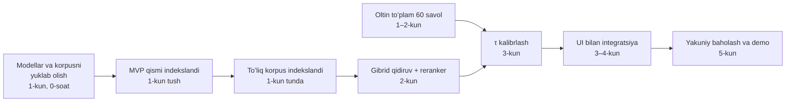
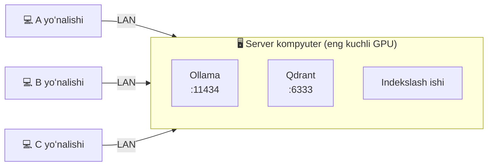
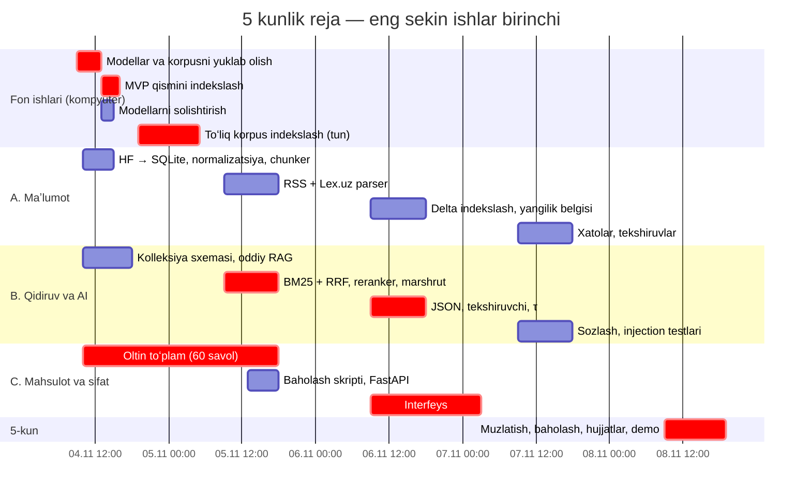

# Lex.uz Huquqiy AI-agent — 5 kunlik reja (v3)

> **Vaziyat:** butun loyihani qurish uchun **5 kun** bor. Bu hujjat [v2 yoʻl xaritasini](lexuz-huquqiy-ai-yol-xaritasi-v2.md) shu muddatga moslaydi. v2 — toʻliq tizimning **uzoq muddatli rejasi** sifatida qoladi; bu fayl — **hozir nima va qaysi tartibda** qilinishini belgilaydi.
>
> **Asosiy tamoyil:** eng **sekin** va eng **katta** qadamlar birinchi boshlanadi. Kompyuter oʻzi ishlaydigan uzoq ishlar (yuklab olish, indekslash, modellarni sinash) — **1-kunning birinchi soatida**, odam vaqtini koʻp oladigan ishlar (test savollari) — **1-kundan**, interfeys — **3-kunda**.

Tushunchalar va vositalar jamoa uchun [I_EXPLAIN.md](I_EXPLAIN.md) da tushuntirilgan.

---

## Mundarija

1. [12 haftadan 5 kunga: nima oʻzgardi](#1-12-haftadan-5-kunga-nima-oʻzgardi)
2. [MVP qamrovi: P0, P1, P2](#2-mvp-qamrovi-p0-p1-p2)
3. [Eng sekin qadamlar va kritik yoʻl](#3-eng-sekin-qadamlar-va-kritik-yoʻl)
4. [Jamoa va kompyuterlar](#4-jamoa-va-kompyuterlar)
5. [Kunma-kun reja](#5-kunma-kun-reja)
6. [Vaqt jadvali](#6-vaqt-jadvali)
7. [Orqada qolsak: kesish rejasi](#7-orqada-qolsak-kesish-rejasi)
8. [Interfeys: «Modda», Hoshiya yoʻnalishi](#8-interfeys-modda-hoshiya-yoʻnalishi)
9. [5 kunlik texnik soddalashtirishlar](#9-5-kunlik-texnik-soddalashtirishlar)
10. [Har kungi tartib va tayyorlik mezonlari](#10-har-kungi-tartib-va-tayyorlik-mezonlari)
11. [Xavflar (5 kun uchun)](#11-xavflar-5-kun-uchun)

---

## 1. 12 haftadan 5 kunga: nima oʻzgardi

| v2 (12 hafta) | v3 (5 kun) | Nega |
|---|---|---|
| Sprintlar ketma-ket, har biri 2 hafta | **Kunlar**, har kun oxirida ishlaydigan natija | Muddat 17 barobar qisqa |
| Ishlar mantiqiy tartibda (maʼlumot → qidiruv → himoya → UI) | Ishlar **davomiyligi** boʻyicha: uzoq fon ishlari birinchi | Indekslash va yuklab olish soatlab davom etadi — ularni kutib oʻtirmaslik kerak |
| Har kim oʻz kompyuterida hammasini ishga tushiradi | **Bitta “server” kompyuter** (eng kuchli GPU): Ollama + Qdrant; boshqalar unga tarmoq orqali ulanadi | Modellarni va indeksni har kim alohida yuklab, qayta hisoblamaydi |
| Toʻliq yangilanish tizimi (A + B + C qatlamlari, versiyalash, havolalar) | **A** (RSS) + **C** (javobdagi yangilik belgisi). B va versiyalash — v1.1 | Talab №6 bajariladi, lekin minimal kod bilan |
| Oltin toʻplam 50 → 200 savol | **60 savol** (shundan 15 tasi javobi yoʻq) | Odam vaqti eng tanqis resurs |
| docker-compose, CI, monitoring | Qdrant + Ollama — Docker’da; API — oddiy `uvicorn`; testlar — `pytest` qoʻlda | Infratuzilma 5 kunda sifat bermaydi |

**Oʻzgarmagan narsalar:** 10 ta talabning hammasi bajariladi — faqat soddalashtirilgan shaklda (2-boʻlim). Arxitektura, metadata sxemasi va «Bilmayman» mantigʻi — v2 dagidek.

---

## 2. MVP qamrovi: P0, P1, P2

* **P0** — boʻlmasa, loyiha topshirilmaydi.
* **P1** — sifat uchun muhim, 4-kun oxirigacha.
* **P2** — vaqt qolsa; aks holda v1.1.

| № | Talab | P0 (shart) | P1 | P2 / v1.1 |
|---|---|---|---|---|
| 1 | Lex.uz maʼlumotlarini oʻqish | HF snapshot (24 267 hujjat) | RSS + yangi hujjatlarni parse qilib indekslash | Kirill versiyalar, toʻliq crawler |
| 2 | Tuzilmali chunking | Modda = boʻlak, uzun modda → band + overlap | Ota-bola kontekst | Jadval/ilova turlari |
| 3 | Metadata | `doc_id`, `title`, `doc_type`, `article_no`, `url`, `status`, `chunk_type` | `amendment_note`, `okoz_codes`, `last_checked_at` | `valid_from/valid_to` versiyalash |
| 4 | Embedding + vektor baza | `bge-m3` dense → Qdrant | BM25 sparse + RRF | — |
| 5 | Faqat kontekstga tayangan javob | Qatʼiy prompt, ekstraktiv uslub | JSON chiqish | — |
| 6 | Savoldan oldin yangilik tekshiruvi | Javobda «Lex.uz bilan solishtirilgan sana» | RSS keshi → «oʻzgargan boʻlishi mumkin» ogohlantirishi | Aylanma tekshiruv (B qatlami) |
| 7 | Aniq manba | Manba bloki **koddan** (metadata) | Manba panelida modda matni + iqtibos belgilangan | — |
| 8 | «Bilmayman» | Reranker bali chegarasi τ | Iqtibos tekshiruvchi | Injection testlari toʻplami |
| 9 | Retriever | Dense qidiruv + filtr `status = active` | Reranker, savol marshrutizatori | Qisqartmalar lugʻatini kengaytirish |
| 10 | Bepul va lokal | Ollama + Qdrant | — | — |
| — | Interfeys | Savol → javob → manba | 8-boʻlimdagi Hoshiya dizayni toʻliq (prototip tayyor) | Telegram bot |
| — | Baholash | 60 savol, Recall@5, yolgʻon javob ulushi | MRR, P50/P95 kechikish | ragas |

---

## 3. Eng sekin qadamlar va kritik yoʻl

Quyidagi vaqtlar — **taxminiy**; har birini 1-kunda birinchi 1–2 soatda **oʻlchab**, keyin rejani aniqlashtiramiz.

| Qadam | Taxminiy vaqt | Kim/nima ishlaydi | Qachon boshlanadi | Qanday tezlashtiriladi |
|---|---|---|---|---|
| **Modellarni yuklab olish** — `qwen3:8b` (5,2 GB), `gemma4:e4b` (~6,6 GB), `bge-m3` (1,2 GB), reranker (~2,3 GB), Llama-3.1-8B-Uz GGUF (~5 GB) | 1–4 soat (internet tezligiga qarab) | Kompyuter, fonda | **1-kun, 0-soat** | Faqat server kompyuterga yuklash; boshqalar unga ulanadi |
| **HF korpusini yuklab olish** (321 MB) | 5–30 daqiqa | Kompyuter | **1-kun, 0-soat** | — |
| **Butun korpusni embedding qilish** — ~47 mln token, ~55–90 ming boʻlak | GPU’da **≈ 0,5–1,5 soat**, CPU’da **≈ 3–8 soat** | Server kompyuter, tunda | **1-kun kechqurun** (avval kichik qism kunduzi) | Avval **MVP qismi** (Konstitutsiya + asosiy kodekslar, ~5–8 ming boʻlak) → 1-kun tushgacha qidiruv ishlaydi; toʻliq korpus tunda. Ish **toʻxtab qolsa davom etadi** (bazada bor boʻlaklar oʻtkazib yuboriladi) |
| **Oltin toʻplam** — 60 savol + toʻgʻri modda + URL | **8–12 kishi-soat** | Odamlar | **1-kun, 1-soat** | Ikki kishiga boʻlish; savollarni HF korpusidagi moddalardan teskari yozish |
| **Modellarni solishtirish** — 3 LLM × 20 savol | 30–90 daqiqa (CPU’da sekin) | Kompyuter, fonda | **1-kun, modellar yuklangach** | Bitta skript, natija jadvalga |
| **Lex.uz HTML parseri** | 6–10 soat | Odam | **2-kun** | 10 ta sahifa 1-kunda **brauzerda qoʻlda** saqlanadi (crawl kerak emas) |
| **Reranker’ni ishlatish** | Har savolda 2–10 s (CPU) | Server | 2-kun | Top-30 emas, top-20; GPU boʻlsa fp16 |
| **τ ni kalibrlash** | 1–2 soat | Odam + skript | 3-kun | Oltin toʻplam tayyor boʻlishi shart |

### 3.1. Kritik yoʻl

Kritik yoʻl — kechiksa, butun loyiha kechikadigan zanjir:



> **Qoida:** kritik yoʻldagi ishni bajarayotgan odamga boshqa vazifa berilmaydi. Fon ishi (indekslash) ishlayotganda o‘sha kompyuterda og‘ir boshqa ish ishga tushirilmaydi.

---

## 4. Jamoa va kompyuterlar

| Yoʻnalish | Masʼuliyat | 5 kun ichidagi asosiy natija |
|---|---|---|
| **A — Maʼlumot** | HF → SQLite, normalizatsiya, chunking, indekslash ishi, RSS, Lex.uz parseri | Toʻliq indeks + yangi hujjatlar oqimi |
| **B — Qidiruv va AI** | Qdrant soʻrovlari, BM25 + RRF, reranker, marshrutizator, LLM, prompt, tekshiruvchi, τ | `/ask` uchidan-uchigacha ishlaydi va «Bilmayman» deya oladi |
| **C — Mahsulot va sifat** | Oltin toʻplam, baholash skripti, FastAPI, interfeys, hujjatlar, demo | Zamonaviy UI + baholash hisoboti |

Jamoa 3 kishidan kam boʻlsa, **C yoʻnalishining oltin toʻplam qismi** birinchi boʻlib boshqa odamlarga taqsimlanadi — u kritik yoʻlda.

**Kompyuterlar:**



* `.env` da `OLLAMA_URL=http://<server-IP>:11434`, `QDRANT_URL=http://<server-IP>:6333`.
* Kerak boʻlsa, tayyor indeks **Qdrant snapshot** sifatida boshqa kompyuterga koʻchiriladi — qayta embedding qilish shart emas.

---

## 5. Kunma-kun reja

Har kunning **birinchi soati** — eng uzoq davom etadigan ishlarni ishga tushirish. **Oxirgi soati** — natijani tekshirish va tungi fon ishini qoʻyish.

### 1-kun — Uzoq ishlarni ishga tushirish va asos

| Vaqt | A — Maʼlumot | B — Qidiruv va AI | C — Mahsulot va sifat |
|---|---|---|---|
| **0-soat** (hamma) | Server kompyuterda: `docker run qdrant`, `ollama pull bge-m3 qwen3:8b gemma4:e4b`, HF korpusini yuklashni boshlash | Reranker va Llama-3.1-8B-Uz GGUF ni yuklashni boshlash | Repozitoriy, `pyproject.toml`, papka tuzilmasi, `.env.example` |
| 1–4-soat | HF → SQLite konvertori; normalizatsiya (`prototypes.py` dan); modda chunker + uzun moddalar boʻlinishi | Modellarni solishtirish skripti (3 LLM × 20 savol) → **fonda ishga tushirish** | **Oltin toʻplam:** savollarni yozish boshlanadi (6 toifa); brauzerda 10 ta Lex.uz sahifasini `tests/fixtures/` ga saqlash |
| 4–5-soat | **Tezlikni oʻlchash:** 1 000 boʻlak embedding → toʻliq korpus vaqtini hisoblash | Qdrant kolleksiya sxemasi: `dense` + `sparse`, payload indekslari | Oltin toʻplam davom etadi |
| 5–8-soat | **MVP qismini indekslash** (Konstitutsiya + asosiy kodekslar) | Birinchi oddiy RAG (faqat dense + LLM) MVP qismi ustida | Prototipni (`frontend/`) jamoa bilan koʻrib chiqish; oltin toʻplam ≥ 30 savol |
| **Kun oxiri** | **Toʻliq korpusni indekslash — tunga** (davom etadigan rejimda) | Modellar solishtirish natijasi → **LLM tanlandi** | — |

**1-kun tayyorlik mezoni:** MVP qismi boʻyicha birinchi savolga javob keladi; LLM tanlangan; oltin toʻplam ≥ 30; toʻliq indekslash tunda ishlayapti.

### 2-kun — Toʻliq qidiruv

| A — Maʼlumot | B — Qidiruv va AI | C — Mahsulot va sifat |
|---|---|---|
| Ertalab: tungi indekslash tugaganini tekshirish (boʻlaklar soni = kutilgan) | BM25 sparse + Qdrant prefetch + **RRF** | Oltin toʻplam → **60 savol** (15 tasi javobi yoʻq) |
| RSS oʻquvchi (`feedparser`), yangi ID lar navbati | **Reranker** (CrossEncoder, top-20 → top-5) | `scripts/run_eval.py`: Recall@5, MRR, yolgʻon javob ulushi |
| **Lex.uz HTML parseri** — `tests/fixtures/` dagi 10 sahifa boʻyicha testlar bilan | Savol marshrutizatori (aniq havola, kirill → lotin) | FastAPI skeleti: `/ask`, `/health`, `/docs/{id}` |

**2-kun tayyorlik mezoni (Demo 1):** CLI’da gibrid qidiruv + reranker bilan toʻliq korpus boʻyicha javob; baholash skripti birinchi Recall@5 ni chiqaradi.

### 3-kun — «Bilmayman» va interfeys

| A — Maʼlumot | B — Qidiruv va AI | C — Mahsulot va sifat |
|---|---|---|
| RSS dagi yangi hujjatlarni parse qilib indekslash (delta) | JSON strukturali chiqish (`pydantic` sxema) | **Prototipni FastAPI `/ask` ga ulash** (`frontend/README.md`), haqiqiy javoblarda holatlarni tekshirish |
| `last_checked_at`, RSS keshi → javobdagi yangilik belgisi | **Iqtibos tekshiruvchi** + Manba blokini koddan yasash | `/ask` ga ulash: javob, manbalar, yangilik belgisi |
| APScheduler: RSS har soatda | **τ ni kalibrlash** oltin toʻplamda | Holatlar: yuklanmoqda, boʻsh, xato, «Bilmayman» |

**3-kun tayyorlik mezoni (Demo 2):** brauzerda savol → tekshirilgan javob + manba; javobi yoʻq savollarga «Bilmayman».

### 4-kun — Integratsiya va sifat

| A — Maʼlumot | B — Qidiruv va AI | C — Mahsulot va sifat |
|---|---|---|
| Xatoliklarni tuzatish; indeks yaxlitligi testlari | **Sozlash:** top-k, τ, prompt; kechikishni kamaytirish (kesh, kichikroq reranker oynasi) | Manba paneli: modda matnida iqtibosni belgilash |
| Snapshot sanasi va Lex.uz havolalarini tekshirish (20 ta tasodifiy) | Prompt-injection va chalgʻituvchi savollar sinovi | Telefon ekrani, klaviatura bilan ishlash, qorongʻi rejim |
| — | Toʻliq baholash: Recall@5, yolgʻon javob, P50/P95 | Kod muzlatilishidan oldin barcha P1 vazifalar |

**4-kun tayyorlik mezoni:** barcha P0 va P1 bajarilgan; baholash hisobotining birinchi versiyasi.

### 5-kun — Muzlatish, hujjatlar, demo

| Vaqt | Hamma |
|---|---|
| Tushgacha | **Yangi funksiya yoʻq** — faqat xatoliklar. Yakuniy baholash; natijalar jadvali |
| Tushdan keyin | README (oʻrnatish, ishga tushirish), I_EXPLAIN yangilanishi, demo ssenariysi (6 ta savol: aniq modda, mavzuviy, kirill, yangi hujjat, javobi yoʻq, chalgʻituvchi) |
| Kechqurun | Demo mashqi; zaxira: indeks snapshot’i va ekran yozuvi (internet yoki kompyuter ishlamay qolsa) |

---

## 6. Vaqt jadvali



*Sanalar 4-noyabrdan boshlanishni nazarda tutadi; boshqa kundan boshlasangiz, faqat sanalarni suring — tartib oʻzgarmaydi. Qizil boʻlaklar — kritik yoʻl.*

---

## 7. Orqada qolsak: kesish rejasi

Har kun oxirida tayyorlik mezoni bajarilmagan boʻlsa, quyidagilar **shu tartibda** kesiladi (avval eng oxirgisi):

| Tartib | Nima kesiladi | Oʻrniga | Taʼsir |
|---|---|---|---|
| 1 | Lex.uz HTML parseri va delta indekslash | RSS’dagi yangi hujjatlar faqat **roʻyxat** sifatida: «Lex.uz’da yangi: …» ogohlantirishi | Talab №6 belgi orqali saqlanadi |
| 2 | Iqtibos tekshiruvchining oʻxshashlik qismi | Faqat `chunk_ids` va raqamlar tekshiruvi | Himoya biroz zaiflashadi, τ saqlanadi |
| 3 | Savol marshrutizatori | Gibrid qidiruv (BM25 raqamlarni baribir topadi) | «MK 131-modda» savollari biroz sekinroq |
| 4 | Toʻliq korpus | Faqat MVP qismi (Konstitutsiya + asosiy kodekslar) | Qamrov kichrayadi, sifat saqlanadi |
| — | **Hech qachon kesilmaydi** | τ chegarasi, koddan yasalgan Manba bloki, «Bilmayman», «yuridik maslahat emas» ogohlantirishi | — |

---

## 8. Interfeys: «Modda», Hoshiya yoʻnalishi

> **Holat:** jamoa B yoʻnalishini («Hoshiya») tanladi va animatsiya, effektlar va 3D qoʻshishni soʻradi. **Ishlaydigan prototip tayyor:** `frontend/` papkasi (namuna maʼlumotlar bilan). 3-kunda faqat FastAPI ulanadi — `frontend/README.md` dagi API shartnomasiga qarang.

### 8.1. Mahsulot, foydalanuvchi va asosiy vazifa

* **Kimlar uchun:** fuqarolar, talabalar, yosh huquqshunoslar — oʻzbek tilida, koʻpincha telefondan.
* **Asosiy vazifa:** savolga **tekshirib boʻladigan** javob olish. Foydalanuvchi javobning har bir gapi qaysi moddaning qaysi soʻzlariga tayanganini **koʻra olishi** kerak.
* **Nomlash:** sayt Lex.uz’ning rasmiy xizmati emas. Nomi — **«Modda»**, sarlavha yonida «Lex.uz maʼlumotlari asosida, rasmiy manba emas».

### 8.2. Dizayn gʻoyasi: hoshiya (kitob chetidagi izoh)

Eski kitoblarda olim matn chetiga izoh yozgan — «hoshiya». Modda ham shunday: **javob — asosiy matn, manba — uning chetidagi izoh**. Har bir gapdan oʻz izohiga ingichka egri chiziq tortiladi, shuning uchun «bu gap qayerdan olingan?» degan savolga koʻz bilan javob topiladi.

**Bitta urgʻu rangi — bayroq yashili.** U faqat bir narsani bildiradi: *manba bilan tasdiqlangan*. Qolgan hamma narsa tinch.

**Esda qoladigan narsa — 3D kitob.** U tizim holatini koʻrsatadi, bezak emas:

| Holat | Kitob nima qiladi |
|---|---|
| Boʻsh | Yopiq, sekin suzib aylanadi |
| Qidirilmoqda | Muqova ochiladi, varaqlar ketma-ket aylanadi |
| Javob | Kichrayib, ochiq holda javob ustida turadi |
| Bilmayman / xato | Yopiladi va biroz chetga buriladi |

Kitob faqat CSS 3D (`transform-style: preserve-3d`) bilan chizilgan: kutubxona yoʻq, rasm yoʻq, yuklanish vaqti qoʻshilmaydi.

### 8.3. Harakatlar (animatsiya)

| Qayerda | Nima boʻladi | Nega |
|---|---|---|
| Javob gaplari | Birin-ketin chiqadi (≈0,4 s oraliq) | Tekshiruv ketma-ketligini sezdiradi |
| Manba raqami | Tasdiqlanganda «muhr bosilgandek» kichrayib tushadi va halqa tarqaladi | «Bu gap tekshirildi» degan lahza |
| Gap chetidagi chiziq | Yuqoridan pastga choʻziladi | Tasdiqlangan gapni belgilaydi |
| Egri chiziq | Faol gapdan izohga chiziladi (`stroke-dashoffset`) | Gap va manbani bogʻlaydi |
| Manba paneli | Oʻngdan suriladi; iqtibos belgilanib, koʻrinadigan joyga suriladi | Toʻliq modda ichida aynan qaysi soʻzlar |
| Yuklanish bosqichlari | Qidiruv → yozish → tekshirish, har biri aylanuvchi belgi bilan | Kutish vaqti tushunarli boʻladi |

`prefers-reduced-motion` yoqilgan boʻlsa, hamma harakat oʻchadi va natija darhol koʻrinadi.

### 8.4. Ranglar va shriftlar

| Nom | Yorugʻ | Qorongʻi | Vazifasi |
|---|---|---|---|
| Fon | `#F5F8F6` | `#0E1613` | Sahifa |
| Sirt | `#FFFFFF` | `#15201B` | Maydonlar, izohlar |
| Siyoh | `#12201A` | `#E4ECE8` | Matn |
| Kul siyoh | `#55645D` | `#9DB0A7` | Rekvizitlar, izohlar |
| **Yashil** | `#1D5A42` | `#7FD6A8` | Tasdiqlangan, havola, asosiy tugma |
| Yalpiz | `#DDF1E6` | `#1B3A2C` | Iqtibos foni, faol gap |
| Ogohlantirish | `#8F5400` / `#FFF3DC` | `#F0B45A` / `#3A2A10` | «Oʻzgargan boʻlishi mumkin» |

| Rol | Shrift |
|---|---|
| Interfeys | **Onest** |
| Savol, javob, modda matni | **Literata** (oʻqish uchun serif) |

Tekshirish sharti: ikkala shrift ham `oʻ`, `gʻ` (U+02BB) va `ʼ` (U+02BC) belgilarini toʻgʻri chizishi kerak — haqiqiy shriftlar bilan brauzerda tekshiriladi.

### 8.5. Sahifa tuzilmasi

```
┌───────────────────────────────────────────────────────────────────────────┐
│ ▮ Modda   Lex.uz maʼlumotlari asosida, rasmiy manba emas  ● Baza holati   │
├───────────────────────────────────────────────────────────────────────────┤
│                           [ ochiq 3D kitob ]                              │
│  Oʻquv taʼtili necha kun beriladi?                                        │
│                                                  ┌──────────────────────┐ │
│ ▌Xodimga har yili kamida 21 kun … beriladi. (1) ─╮│ 1  3-modda. Taʼtil   │ │
│                                                  ╰┤ «kamida 21 kalendar…»│ │
│ ▌Taʼtil qismlarga boʻlinishi mumkin. (1)          │ Toʻliq moddani koʻrish│ │
│ ▌Taʼtil haqi … 3 kun oldin toʻlanadi. (2)         └──────────────────────┘ │
│                                                  ┌──────────────────────┐ │
│  3 ta gapning har biri manba bilan solishtirildi  │ 2  4-modda. Taʼtil   │ │
│  Lex.uz bilan 2026-yil 1-noyabrda solishtirilgan  │ haqi …               │ │
│                                                  └──────────────────────┘ │
│              ┌─ Keyingi savolingizni yozing ────────────[Soʻrash]┐        │
└───────────────────────────────────────────────────────────────────────────┘
```

* Izoh oʻz gapi bilan bir balandlikda turadi; ikki izoh toʻqnashsa, pastkisi suriladi.
* Telefonda (≤ 900 px) izohlar gap ostiga tushadi, egri chiziqlar yoʻqoladi.
* «Toʻliq moddani koʻrish» — oʻngdan chiqadigan panel: modda matni, belgilangan iqtibos, tahrir izohi, «Lex.uz’da ochish». Esc yopadi, fokus panel ichida qoladi va yopilganda tugmaga qaytadi.

**Holatlar** (hammasi prototipda bor):

| Holat | Nima koʻrinadi | Prototipda qanday ochiladi |
|---|---|---|
| Boʻsh | 3D kitob, sarlavha, savol maydoni, 3 ta namunaviy savol | Sahifani ochish |
| Yuklanmoqda | Ochilgan kitob + 3 bosqich | Istalgan savol |
| Javob | Yuqoridagi tuzilma | «Oʻquv taʼtili necha kun beriladi?» |
| Eskirgan manba | Izohda va pastda ogohlantirish rangida xabar | «Taʼtil haqi qachon toʻlanadi?» |
| Bilmayman | «Bu savolga Lex.uz maʼlumotlari asosida ishonchli javob topilmadi.» + maslahat + Lex.uz qidiruviga havola | Taʼtilga aloqasiz savol |
| Server xatosi | «Javob olishning imkoni boʻlmadi» + «Qayta urinish» | `index.html?demo=error&q=test` |

### 8.6. Tamoyillar

* Bitta urgʻu rangi — yashil. U faqat **tasdiqlangan** narsani bildiradi.
* Harakat holatni tushuntiradi, bezak uchun emas.
* «Bilmayman» xato emas — qizil emas, oddiy siyoh rangida, aniq keyingi qadam bilan.
* Hamma yozuv — gap shaklida, katta harfli yorliqlar yoʻq.
* Klaviatura bilan toʻliq ishlaydi; fokus koʻrinadi; `prefers-reduced-motion` hurmat qilinadi; qorongʻi rejim bor.
* Telefondan boshlab: 390 px kenglikda gorizontal aylantirish yoʻq.
* Manba bloki matnini model emas, **kod** metadata’dan yasaydi (5-boʻlim, 3-kun).

---

## 9. 5 kunlik texnik soddalashtirishlar

| v2 dagi reja | 5 kunda | Qachon qaytariladi |
|---|---|---|
| SQLite + Qdrant + versiyalash jadvallari | SQLite: `documents`, `chunks`, `sync_log` (versiyalarsiz) | v1.1 |
| Uch qatlamli yangilanish (A, B, C) | A (RSS har soatda) + C (javobdagi belgi) | B — v1.1 |
| Oʻzgartirish havolalari (`CROSS_REF`) | Yoʻq; RSS’dagi «oʻzgartirish kiritish» hujjatlari faqat ogohlantirish uchun | v1.1 |
| Lex.uz’da jonli qidiruv | Yoʻq; «Bilmayman» + Lex.uz qidiruv havolasi | v1.1 |
| docker-compose (API ham) | Qdrant + Ollama Docker’da, API — `uvicorn` | 5-kun, vaqt qolsa |
| CI (GitHub Actions) | `pytest` qoʻlda, har kuni kechqurun | v1.1 |
| Oltin toʻplam 150–200 | 60 | v1.1 |
| Telegram bot | Yoʻq | v1.1 |

---

## 10. Har kungi tartib va tayyorlik mezonlari

**Har kuni:**

* **09:00 — 15 daqiqalik qisqa yigʻilish:** kecha nima tugadi, bugun nima, nima toʻsib turibdi. Birinchi savol: **tungi fon ishi tugadimi?**
* **13:00 — tekshiruv nuqtasi:** kritik yoʻldagi ish rejadami? Orqada boʻlsa — 7-boʻlimdagi kesish rejasi.
* **18:00 — kun yakuni:** tayyorlik mezoni tekshiriladi; `pytest`; `run_eval.py`; **tungi fon ishi ishga tushiriladi**.

| Kun | Tayyorlik mezoni |
|---|---|
| 1 | MVP qismi boʻyicha birinchi javob; LLM tanlangan; oltin toʻplam ≥ 30; toʻliq indekslash tunda ishlayapti |
| 2 | Toʻliq korpus indekslangan; gibrid + reranker; Recall@5 oʻlchangan; oltin toʻplam = 60 |
| 3 | Brauzerda savol → tekshirilgan javob + manba; «Bilmayman» ishlaydi; τ kalibrlangan |
| 4 | Barcha P0 + P1; yolgʻon javob ulushi oʻlchangan; telefon ekranida ishlaydi |
| 5 | Yakuniy hisobot, README, demo mashqi, zaxira nusxa |

**MVP sifat maqsadlari (5 kun uchun):**

| Metrika | Maqsad |
|---|---|
| Recall@5 | ≥ 0,80 |
| Yolgʻon javob ulushi (javobi yoʻq 15 savol) | ≤ 1 ta savol |
| Ortiqcha «Bilmayman» | ≤ 15 % |
| P50 kechikish (server kompyuterda) | ≤ 15 s |

---

## 11. Xavflar (5 kun uchun)

| Xavf | Belgisi | Chora |
|---|---|---|
| Internet sekin — modellar 1-kun tushgacha yuklanmaydi | 0-soatdan keyin 2 soatda yuklash < 50 % | Eng kichik modellar bilan boshlash (`qwen3:4b`, faqat `bge-m3`); qolganini tunda |
| Server kompyuterda GPU yoʻq — toʻliq indekslash 8 soatdan oshadi | 1 000 boʻlak tezligi oʻlchovida | MVP qismi bilan qolish (7-boʻlim, 4-band); toʻliq korpusni 2-tunga qoldirish |
| Oʻzbek tilida LLM javoblari sifatsiz | Modellar solishtirishida | Ekstraktiv uslubni kuchaytirish (iqtiboslardan javob); oʻzbekchaga moslangan modelni tanlash |
| Oltin toʻplam kechikadi | 2-kun tushda < 40 savol | Savollarni HF moddalaridan teskari yozish; ikki kishiga boʻlish |
| Lex.uz parseri murakkab chiqadi | 2-kun oxirida testlar oʻtmayapti | Kesish rejasi, 1-band |
| Integratsiya oxirgi kunga qolib ketadi | 3-kun oxirida brauzerda javob yoʻq | 4-kun ertalab yangi funksiyalar toʻxtatiladi, faqat integratsiya |
| Demo kuni nimadir ishlamaydi | — | Indeks snapshot’i, oldindan yozilgan demo videosi, oflayn ishlaydigan server kompyuter |

---

*Hujjat versiyasi: 3.0 (5 kunlik reja) · Sana: 2026-11-04 · Asos: v2 yoʻl xaritasi · Til: oʻzbek (lotin)*
