# 🎓 I_EXPLAIN — RAG’ni noldan tushunamiz

Bu qo‘llanma loyihada ishlatilgan **barcha tushunchalarni** yangi boshlovchi uchun oddiy tilda tushuntiradi: *chunk*, *overlap*, *embedding*, *retriever*, *RAG*, *vektor bazasi*, *prompt*, *API* va boshqalar. Har bir tushuncha uch qismdan iborat:

1. **Oddiy o‘xshatish** — hayotiy misol.
2. **Rasm yoki sxema.**
3. **Loyihada qayerda** — qaysi faylda va qanday sozlama bilan ishlatilgani.

> 📷 **Rasmlar haqida.** Matnli rasmlar (bo‘laklash, overlap, tozalash, prompt) loyihaning **haqiqiy kodi** namuna kitob ustida ishga tushirilib chizilgan. Vektorli rasmlar (strelkalar, nuqtalar) esa **soddalashtirilgan sxema**: haqiqiy embedding’da yuzlab o‘lcham bor, ularni qog‘ozda chizib bo‘lmaydi. Barcha rasmlarni qayta chizish uchun: `python docs/explain/make_figures.py`.

Asosiy texnik hujjat — [README.md](README.md). Bu fayl esa “nima uchun va qanday ishlaydi” degan savollarga javob beradi.

---

## 📑 Mundarija

0. [Katta rasm: bitta savolning sayohati](#0-katta-rasm-bitta-savolning-sayohati)
1. [LLM — katta til modeli](#1-llm--katta-til-modeli)
2. [RAG — qidiruv bilan boyitilgan generatsiya](#2-rag--qidiruv-bilan-boyitilgan-generatsiya)
3. [Matnni ajratib olish va tozalash](#3-matnni-ajratib-olish-va-tozalash)
4. [Chunk — bo‘lak](#4-chunk--bolak)
5. [Chunk overlap — bo‘laklarning ustma-ust qismi](#5-chunk-overlap--bolaklarning-ustma-ust-qismi)
6. [Embedding — matnni songa aylantirish](#6-embedding--matnni-songa-aylantirish)
7. [Kosinus o‘xshashligi — ikki matn qanchalik yaqin?](#7-kosinus-oxshashligi--ikki-matn-qanchalik-yaqin)
8. [Vektor bazasi (ChromaDB)](#8-vektor-bazasi-chromadb)
9. [Retriever — qidiruvchi](#9-retriever--qidiruvchi)
10. [Prompt — modelga beriladigan topshiriq](#10-prompt--modelga-beriladigan-topshiriq)
11. [Generatsiya — javob yozish](#11-generatsiya--javob-yozish)
12. [API, OpenRouter va bepul limitlar](#12-api-openrouter-va-bepul-limitlar)
13. [Sifatni o‘lchash: hit@k va MRR](#13-sifatni-olchash-hitk-va-mrr)
14. [Veb-sayt tushunchalari](#14-veb-sayt-tushunchalari)
15. [Hammasi birga: real misol](#15-hammasi-birga-real-misol)
16. [O‘zingizni tekshiring](#16-ozingizni-tekshiring)
17. [Qisqa lug‘at](#17-qisqa-lugat)

---

## 0. Katta rasm: bitta savolning sayohati

Avval butun tizimni bir qarashda ko‘rib chiqamiz. Keyingi bo‘limlarda har bir qutichani alohida tushuntiramiz.

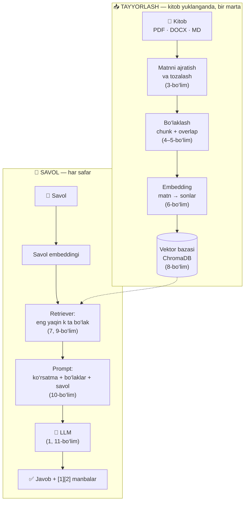

Bitta jumlada: **kitobni mayda bo‘laklarga bo‘lamiz, har bo‘lakning “ma’no manzilini” saqlaymiz. Savol kelganda unga eng yaqin bo‘laklarni topib, modelga “shularga qarab javob ber” deymiz.**

---

## 1. LLM — katta til modeli

**LLM** (Large Language Model) — juda ko‘p matn ustida o‘qitilgan dastur. U bitta ishni juda yaxshi qiladi: **berilgan matndan keyin qaysi so‘z kelishini taxmin qiladi**. Shu tarzda so‘zma-so‘z javob yozadi. Loyihamizda LLM — `google/gemma-4-31b-it:free`.

**O‘xshatish:** LLM ko‘p kitob o‘qigan, xotirasi kuchli, lekin **kutubxonaga kira olmaydigan** olimga o‘xshaydi. U faqat yodida qolgan narsani biladi.

LLM’ning uchta muhim cheklovi bor. Aynan shular uchun RAG kerak:

| Cheklov | Ma’nosi | Misol |
|---|---|---|
| **Sizning hujjatlaringizni bilmaydi** | Model o‘qitilgan paytda sizning kitobingiz yoki konspektingiz unda bo‘lmagan | “Mening PDF’imning 3-bobida nima deyilgan?” — bilmaydi |
| **Bilim chegarasi** | Model ma’lum sanagacha bo‘lgan ma’lumot bilan o‘qitilgan | Yangi hisobot yoki yangi qonunni bilmaydi |
| **Gallyutsinatsiya** | Bilmasa ham, ishonch bilan “to‘qib” javob berishi mumkin | Mavjud bo‘lmagan sana yoki raqamni aytadi |

**Token nima?** Model matnni harflar yoki so‘zlar bilan emas, **tokenlar** bilan o‘qiydi. Token — so‘z yoki so‘zning bir bo‘lagi. Ingliz tilida 1 token taxminan 4 belgi yoki ¾ so‘zga teng. Modelning **kontekst oynasi** — u bir martada “ko‘ra oladigan” tokenlar soni. Gemma 4 uchun bu 256 mingtacha token. Kontekst oynasi katta bo‘lsa ham, butun kutubxonani har safar modelga yuborib bo‘lmaydi: bu sekin va qimmat, sifat ham pasayadi. Shuning uchun kerakli parchalarni **tanlab** beramiz.

---

## 2. RAG — qidiruv bilan boyitilgan generatsiya

**RAG** = **R**etrieval-**A**ugmented **G**eneration. Uchala so‘z — uchta qadam:

| Harf | Inglizcha | O‘zbekcha | Loyihada |
|---|---|---|---|
| **R** | Retrieval | Qidirib topish | `rag.py → retrieve()` — savolga eng mos bo‘laklarni topadi |
| **A** | Augmented | Boyitish | `rag.py → build_prompt()` — topilgan bo‘laklarni savolga qo‘shadi |
| **G** | Generation | Yaratish | `rag.py → generate()` — LLM shular asosida javob yozadi |

**O‘xshatish — imtihon:**

* **Oddiy LLM** — **yopiq kitobli** imtihon. Talaba faqat yodidagini yozadi va bilmasa to‘qib yuborishi mumkin.
* **RAG** — **ochiq kitobli** imtihon. Talaba avval kitobdan kerakli sahifani topadi, so‘ng o‘sha sahifaga qarab javob yozadi va “3-bob, 41-bet” deb manbani ko‘rsatadi.

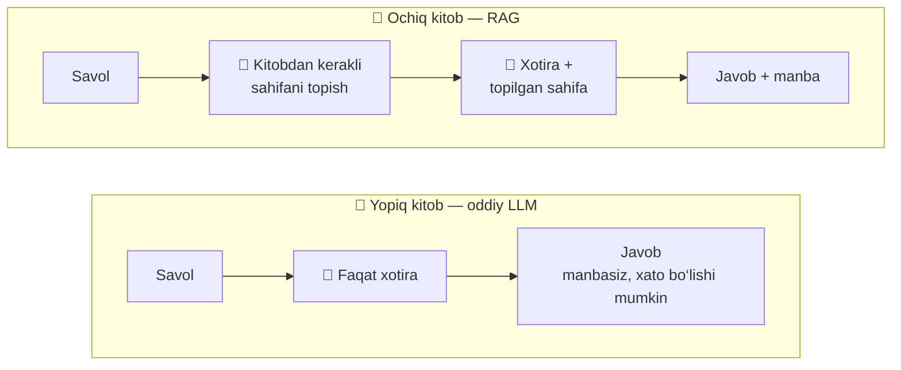

**RAG o‘rniga modelni qayta o‘qitsa bo‘lmaydimi (fine-tuning)?** Bo‘ladi, lekin bizning vazifamiz uchun RAG ancha qulay:

| | RAG | Modelni qayta o‘qitish (fine-tuning) |
|---|---|---|
| Yangi kitob qo‘shish | Saytga yuklash kifoya — bir necha daqiqa | Modelni qaytadan o‘qitish kerak — soatlab, GPU bilan |
| Narx | Bepul modellar bilan ham ishlaydi | Qimmat hisoblash resurslari |
| Manba ko‘rsatish | Ha — qaysi bo‘lakdan olingani aniq | Yo‘q — bilim model ichiga “erib” ketadi |
| Kitobni o‘chirish | Bitta tugma | Modelni qaytadan o‘qitish kerak |

---

## 3. Matnni ajratib olish va tozalash

Kompyuter uchun PDF — bu “qaysi harf sahifaning qaysi nuqtasida turishi” haqidagi ko‘rsatmalar to‘plami, oddiy matn emas. Shuning uchun avval **matnni ajratib olish** (*text extraction*) kerak:

| Format | Kutubxona | Nima qiladi |
|---|---|---|
| PDF | `pypdf` | Har bir sahifadan matnni oladi |
| DOCX | `python-docx` | Word paragraflari, sarlavhalari va jadvallarini hujjatdagi tartibda oladi |
| Markdown, TXT | — | Oddiy matn, to‘g‘ridan-to‘g‘ri o‘qiladi |

PDF’dan chiqqan matnda “axlat” ko‘p bo‘ladi: har sahifada takrorlanadigan sarlavha, sahifa raqamlari, qator oxirida bo‘lingan so‘zlar. Agar ular tozalanmasa, “17” yoki “THE TOYOTA WAY” kabi qatorlar bo‘laklarga kirib, qidiruvni chalg‘itadi.

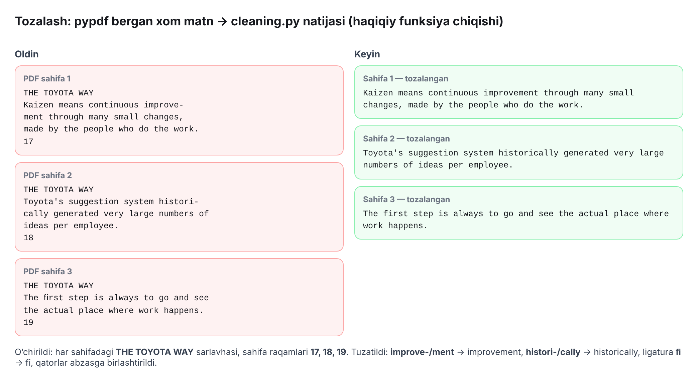

*Bu rasm `cleaning.py` dagi haqiqiy funksiyalarning chiqishi. Chapda — pypdf bergan xom matn, o‘ngda — tozalangan matn.*

**Metadata** — matn haqidagi ma’lumot: qaysi kitob, qaysi bob, qaysi sahifa. **O‘xshatish:** kutubxonadagi kitob kartochkasi. Kitobning o‘zi emas, lekin uni topishga va manbani ko‘rsatishga yordam beradi. Loyihada har bir bob `Document` obyektiga aylanadi: `text` (matn) + `metadata` (`source_book`, `chapter`, `chapter_title`, `page_start`…). Javobdagi “Toyota Integrated Report 2023 (p. 14)” yozuvi aynan shu metadatadan olinadi.

📁 Loyihada: `toyota_rag/loaders.py`, `toyota_rag/cleaning.py`.

---

## 4. Chunk — bo‘lak

**Chunk (bo‘lak)** — kitob matnining kichik, mustaqil qismi. Loyihamizda bo‘lak **ko‘pi bilan 800 belgi** (taxminan 1–2 abzas).

**O‘xshatish:** butun pitsani bir tishlashda yeb bo‘lmaydi — uni bo‘laklarga kesamiz. Lekin har bir bo‘lakda bir oz pishloq, bir oz xamir bo‘lishi kerak, ya’ni har bir bo‘lak o‘zicha **to‘liq ma’noga** ega bo‘lishi kerak.

**Nega butun kitobni bitta qilib saqlamaymiz?**

1. **Aniqlik.** Savol odatda bitta aniq fikr haqida bo‘ladi (masalan, “takt time qanday hisoblanadi?”). Bitta abzasni topish butun bobni topishdan ancha aniq.
2. **Prompt hajmi.** Modelga 4 ta kichik bo‘lak berish 4 ta butun bobni berishdan tez, arzon va sifatliroq.
3. **Embedding sifati.** Bitta bo‘lakni bitta vektor ifodalaydi (6-bo‘lim). Bo‘lakda o‘nta mavzu aralashsa, uning vektori hech qaysi mavzuni yaxshi ifodalamaydi.

Quyida namuna kitobdagi bitta abzas haqiqiy `RecursiveOverlapSplitter` bilan qanday bo‘linishi ko‘rsatilgan. Ko‘rinarli bo‘lishi uchun bo‘lak hajmi kichik tanlangan (260 belgi):

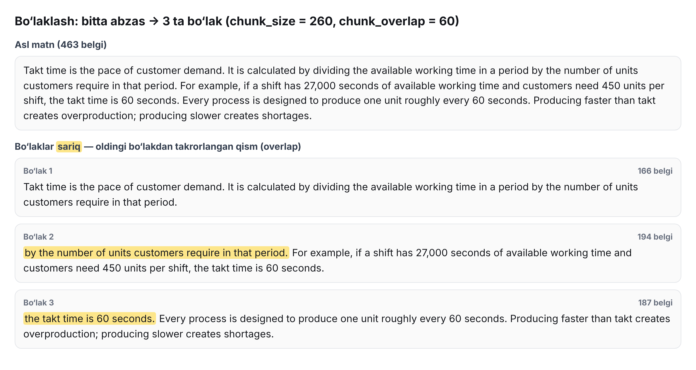

### Bo‘lak hajmini qanday tanlash kerak?

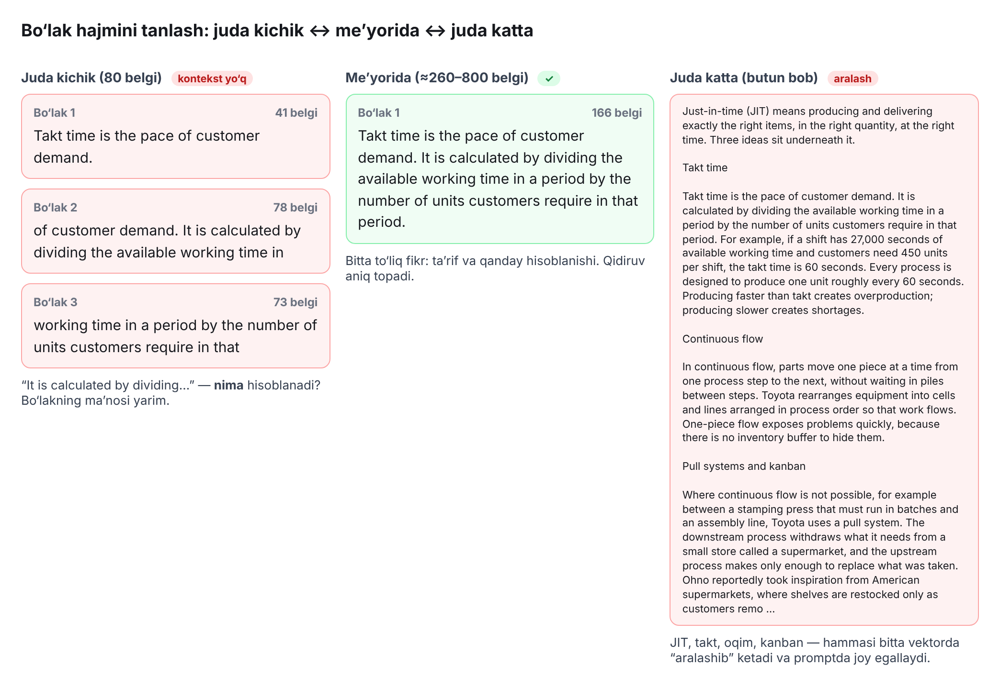

| Hajm | Muammo |
|---|---|
| Juda kichik (≈50–100 belgi) | Fikr yarmida uziladi: “It is calculated by…” — *nima* hisoblanadi? Kontekst yo‘q |
| **Me’yorida (≈500–1000 belgi)** | **Bitta to‘liq fikr — qidiruv aniq topadi, promptga ko‘p joy olmaydi** |
| Juda katta (butun bob) | Ko‘p mavzu aralashadi, vektor “xira” bo‘ladi, prompt to‘lib ketadi |

### Bo‘laklash algoritmi — “rekursiv” nimani anglatadi?

Matnni har 800 belgida “qaychi bilan” kesish yomon: gap yoki hatto so‘z o‘rtasidan kesilib qoladi. Shuning uchun **rekursiv** usul ishlatiladi. Algoritm avval eng katta tabiiy chegarada bo‘lishga harakat qiladi, sig‘masa — kichikroq chegarada:

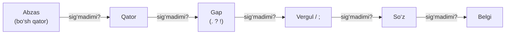

**O‘xshatish:** kitobni papkalarga joylash. Avval butun boblarni joylaysiz. Bob sig‘masa — bo‘limlarga, bo‘lim ham sig‘masa — sahifalarga ajratasiz. Varaqni yirtish esa eng oxirgi chora.

📁 Loyihada: `toyota_rag/chunking.py`, sozlamalar `.env` da: `CHUNK_SIZE=800`.

---

## 5. Chunk overlap — bo‘laklarning ustma-ust qismi

**Overlap** — har bir yangi bo‘lak **oldingi bo‘lakning oxirgi qismi bilan boshlanishi**. Loyihamizda bu ≈150 belgi.

**O‘xshatish — panorama surat:** telefonda panorama olayotganda har bir yangi kadr oldingisining bir qismini ham qamrab oladi. Shunda kadrlar orasida “tirqish” qolmaydi va ular bir-biriga silliq ulanadi. Overlap ham xuddi shunday: bo‘laklar chegarasida ma’no yo‘qolmaydi.

Quyida **bir xil abzas** ikki xil sozlama bilan bo‘lingan. Bu ham haqiqiy kod natijasi:

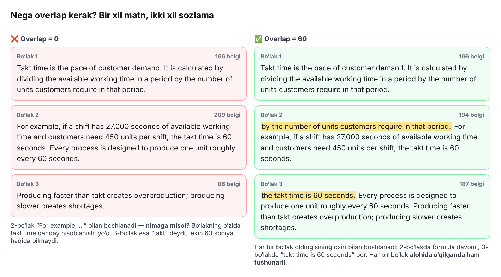

Chap tomonga qarang: overlap bo‘lmasa, 2-bo‘lak “**For example, …**” bilan boshlanadi. Bu bo‘lakni alohida o‘qigan odam ham, model ham “nimaga misol?” deb hayron qoladi. Retriever esa bo‘laklarni **alohida-alohida** topadi va modelga beradi (9-bo‘lim). Shuning uchun **har bir bo‘lak o‘zicha tushunarli bo‘lishi** juda muhim.

**Qancha overlap kerak?** Odatiy tavsiya — bo‘lak hajmining **10–20 foizi**. Bizda: 150 / 800 ≈ 19%.

* Juda kam (0) bo‘lsa — chegaradagi kontekst yo‘qoladi.
* Juda ko‘p (masalan, 50%) bo‘lsa — har bir matn ikki marta saqlanadi, bo‘laklar soni va API so‘rovlari ikki barobar ko‘payadi.

> 💡 **Qiziq fakt.** Mashhur LangChain kutubxonasidagi `RecursiveCharacterTextSplitter` overlap’ni faqat 150 belgidan **qisqa** bo‘laklarga qo‘sha oladi. Abzaslar odatda uzunroq bo‘lgani uchun amalda ko‘p bo‘laklar overlap’siz qoladi. Loyihamizdagi `RecursiveOverlapSplitter` esa **har bir** qo‘shni juftlikda overlap bo‘lishini kafolatlaydi. Imkon bo‘lsa, butun gaplarni ko‘chiradi, bo‘lmasa — oxirgi so‘zlarni. Bu testlarda ham tekshiriladi.

📁 Loyihada: `toyota_rag/chunking.py`, `.env` da: `CHUNK_OVERLAP=150`.

---

## 6. Embedding — matnni songa aylantirish

Kompyuter so‘zlarning ma’nosini “tushunmaydi”, u faqat sonlar bilan ishlaydi. **Embedding** — matnni **sonlar ro‘yxatiga (vektorga)** aylantirish. Bunda **ma’nosi yaqin matnlar yaqin sonlarga** ega bo‘ladi.

**O‘xshatish — xarita koordinatalari:** Toshkent va Chirchiq koordinatalari bir-biriga yaqin, Toshkent va Tokio — uzoq. Embedding ham har bir matnga **“ma’no xaritasidagi koordinata”** beradi. “Kanban” va “pull tizimi” yaqin joylashadi, “kanban” va “Prius batareyasi” — uzoqda.

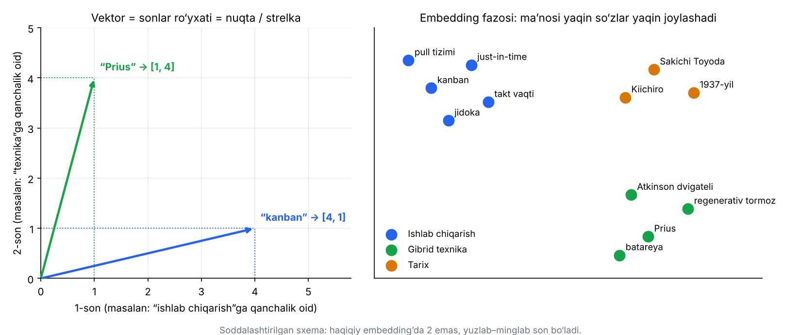

* **Chap rasm.** Vektor — bu shunchaki sonlar ro‘yxati, masalan `[4, 1]`. Uni nuqta yoki strelka sifatida chizish mumkin. Bu yerda o‘qlarning ma’nosi o‘ylab topilgan (“ishlab chiqarishga qanchalik oid”, “texnikaga qanchalik oid”).
* **O‘ng rasm.** Haqiqiy embedding modeli o‘qlarning ma’nosini **o‘zi o‘rganadi**, va o‘qlar 2 ta emas, **yuzlab yoki minglab** bo‘ladi. Natijada bir mavzudagi matnlar bir “mahallaga” to‘planadi.

**Muhim:** embedding so‘zlarning **ma’nosini** ushlaydi, yozilishini emas. “Car” va “automobile” bir xil yozilmaydi, lekin vektorlari yaqin bo‘ladi. Oddiy kalit so‘z bo‘yicha qidiruv (Ctrl+F) bunday sinonimlarni topa olmaydi.

### Loyihada embedding qanday ishlatiladi

| Narsa | Qiymat | Izoh |
|---|---|---|
| Model | `nvidia/nemotron-3-embed-1b:free` | OpenRouter orqali bepul |
| Bo‘laklar uchun | `input_type = "search_document"` | “Bu — qidiriladigan hujjat” |
| Savol uchun | `input_type = "search_query"` | “Bu — savol”. Model savol va hujjatni biroz boshqacha kodlaydi, bu qidiruvni aniqlashtiradi |
| Paket (batch) | 64 ta matn bitta so‘rovda | 600 bo‘lak → atigi 10 ta so‘rov |
| Sarlavha qo‘shish | `Kitob nomi - Bob nomi` + bo‘lak matni | Bo‘lakning o‘zida mavzu nomi ko‘pincha yozilmagan bo‘ladi |
| Normallashtirish | Vektor uzunligi 1 ga keltiriladi | Kosinusni hisoblash osonlashadi (7-bo‘lim) |

**Muhim qoida:** savol va bo‘laklar **bir xil model** bilan vektorga aylantirilishi kerak. Har xil modellarning “xaritalari” har xil, ularni solishtirib bo‘lmaydi. Shuning uchun embedding modelini o‘zgartirsangiz, bazani qaytadan qurish kerak (`ingest.py --reset`).

📁 Loyihada: `toyota_rag/embeddings.py`.

---

## 7. Kosinus o‘xshashligi — ikki matn qanchalik yaqin?

Ikki vektor qanchalik yaqinligini o‘lchashning eng mashhur usuli — **kosinus o‘xshashligi** (*cosine similarity*). U ikki strelka orasidagi **burchakka** qaraydi: burchak qancha kichik bo‘lsa, ma’no shuncha yaqin.

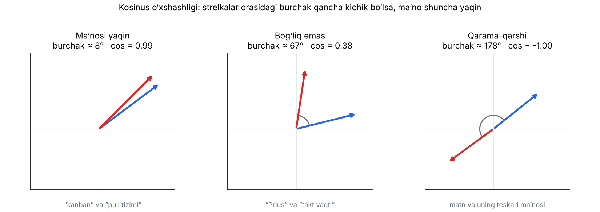

| Burchak | cos | Ma’nosi |
|---|---|---|
| 0° | **1** | Ma’nosi bir xil |
| 90° | **0** | Bir-biriga bog‘liq emas |
| 180° | **−1** | Qarama-qarshi |

Formula:

$$
\cos\theta = \frac{A \cdot B}{\lVert A \rVert \times \lVert B \rVert}
= \frac{\text{mos sonlar ko‘paytmalari yig‘indisi}}{\text{A uzunligi} \times \text{B uzunligi}}
$$

### Qo‘lda hisoblaymiz

Savol vektori `Q = [1, 2, 0]`, bazada ikkita bo‘lak bor: `D1 = [2, 3, 1]` va `D2 = [0, 1, 3]`.

| | Q · D (ko‘paytmalar yig‘indisi) | ‖Q‖ | ‖D‖ | cos |
|---|---|---|---|---|
| **D1** | 1·2 + 2·3 + 0·1 = **8** | √5 ≈ 2.236 | √14 ≈ 3.742 | 8 / (2.236 × 3.742) ≈ **0.956** |
| **D2** | 1·0 + 2·1 + 0·3 = **2** | √5 ≈ 2.236 | √10 ≈ 3.162 | 2 / (2.236 × 3.162) ≈ **0.283** |

Demak, **D1 savolga ancha yaqin** (0.956 > 0.283), retriever avval D1 ni qaytaradi. Haqiqiy tizim xuddi shu hisobni yuzlab o‘lchamli vektorlar bilan bajaradi.

ChromaDB “masofa” qaytaradi: `masofa = 1 − cos`. Loyiha uni yana o‘xshashlikka aylantiradi: `score = 1 − masofa`. Saytda har bir manba yonidagi yashil chiziq va `0.71` kabi son — aynan shu kosinus o‘xshashligi.

---

## 8. Vektor bazasi (ChromaDB)

**Vektor bazasi** — vektorlarni saqlaydigan va **“shu vektorga eng yaqin vektorlar qaysi?”** degan savolga tez javob beradigan maxsus ma’lumotlar bazasi.

**O‘xshatish — kutubxona katalogi:** oddiy katalogda kitoblar alifbo tartibida turadi. Vektor bazasida esa **ma’nosi bo‘yicha** turadi: “ishlab chiqarish” haqidagi bo‘laklar bir javonda, “gibrid texnika” haqidagilar boshqasida.

Loyihamizda har bir bo‘lak uchun ChromaDB’da to‘rtta narsa saqlanadi:

| Maydon | Misol | Nima uchun |
|---|---|---|
| `id` | `a8c276eae165-toyota_history-ch1-000` | Har bir bo‘lakning noyob nomi (takrorlanmasligi uchun) |
| `embedding` | `[0.021, −0.113, 0.087, …]` | O‘xshashlik bo‘yicha qidirish uchun |
| `document` | “Takt time is the pace of customer demand…” | Modelga kontekst sifatida berish uchun |
| `metadata` | `{book_id, source_book, chapter, …}` | Manbani ko‘rsatish va kitob bo‘yicha filtrlash uchun |

**Oddiy qidiruv (kalit so‘z) bilan farqi:**

| Savol | Kalit so‘z qidiruvi (Ctrl+F) | Vektor qidiruvi |
|---|---|---|
| “How does Toyota reduce **inventory**?” | Faqat “inventory” so‘zi bor joylarni topadi | “stock”, “supermarket”, “just-in-time” haqidagi bo‘laklarni ham topadi |
| Sinonimlar, boshqa so‘z bilan aytilgan fikr | ❌ Topa olmaydi | ✅ Ma’no bo‘yicha topadi |
| Aniq kod, ism, raqam (“LS 400”) | ✅ Juda yaxshi | Ba’zan yomonroq |

**HNSW — tez qidirish siri.** Million bo‘lakni har safar savol bilan birma-bir solishtirish sekin bo‘lardi. ChromaDB **HNSW** degan “qo‘shnilar grafi”dan foydalanadi. **O‘xshatish:** shahardan kimnidir qidirayotganda har bir uyni taqillatmaysiz. Tanishingizdan so‘raysiz, u o‘z tanishiga yo‘naltiradi va bir necha qadamda kerakli odamga yetib borasiz. HNSW ham vektorlar orasida shunday “tanishlar zanjiri” bo‘ylab tez yuradi.

**Nega aynan ChromaDB?** U Python ichida ishlaydi va ma’lumotlarni oddiy papkada (`chroma_toyota_db/`) saqlaydi: server o‘rnatish shart emas. Bizning hajm (bir necha ming bo‘lak) uchun bu yetarli. Katta production tizimlar uchun Qdrant kabi alohida server-bazalar qulayroq.

📁 Loyihada: `toyota_rag/vectorstores.py`.

---

## 9. Retriever — qidiruvchi

**Retriever** — RAG’ning “R” qismi. U savolni vektorga aylantiradi va bazadan **eng yaqin `k` ta bo‘lakni** qaytaradi. Biz uchun standart qiymat `k = 4`.

**O‘xshatish:** kutubxonachiga savol berasiz: “Just-in-time haqida nima bor?” U butun kutubxonani sizga bermaydi — eng mos **4 ta sahifani** belgilab beradi.

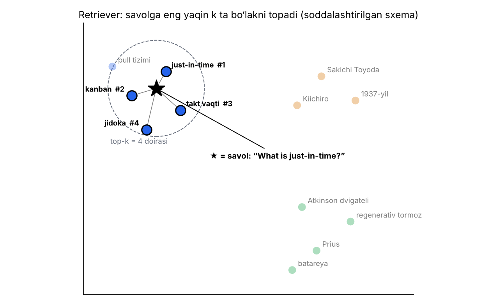

Rasmda ⭐ — savol. Eng yaqin 4 ta nuqta (qora chegarali) tanlanadi va `#1…#4` tartibida modelga beriladi. “Prius” yoki “1937-yil” kabi uzoqdagi bo‘laklar tanlanmaydi.

### k ni qanday tanlash kerak?

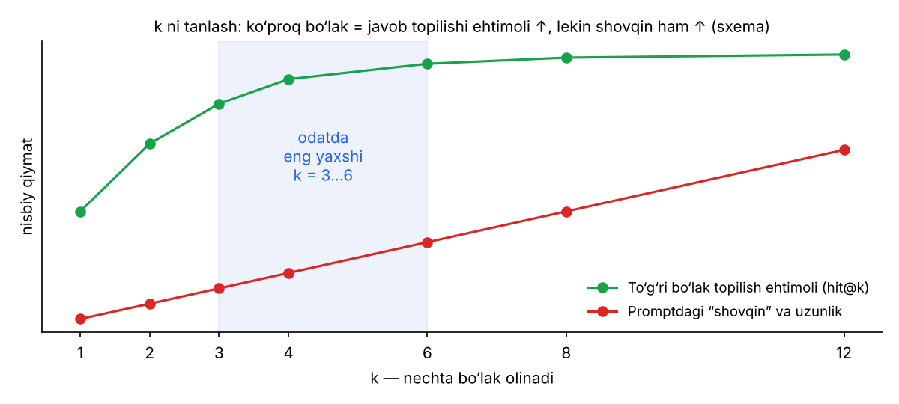

* **k kichik** (1–2): kerakli bo‘lak ro‘yxatga tushmay qolishi mumkin.
* **k katta** (10+): kerakli bo‘lak albatta bor, lekin promptga keraksiz “shovqin” ham ko‘p tushadi. Model chalg‘iydi, javob sekinlashadi.
* Odatda **3–6** yaxshi ishlaydi. Saytda k ni pastdagi ro‘yxatdan o‘zgartirish mumkin.

**Filtr.** Retriever faqat **belgilangan kitoblar** ichidan qidira oladi. Saytdagi ☑ belgilar aynan shu filtrni boshqaradi: `where={"book_id": [...]}`.

📁 Loyihada: `toyota_rag/rag.py → ToyotaRAG.retrieve()`.

---

## 10. Prompt — modelga beriladigan topshiriq

**Prompt** — modelga yuboriladigan to‘liq matn. RAG’dagi **“A” (Augmented — boyitilgan)** qismi aynan shu: oddiy savolni topilgan bo‘laklar bilan **boyitamiz**.

Quyida loyihamiz modelga yuboradigan haqiqiy prompt ko‘rsatilgan (`build_prompt` funksiyasi chiqishi):

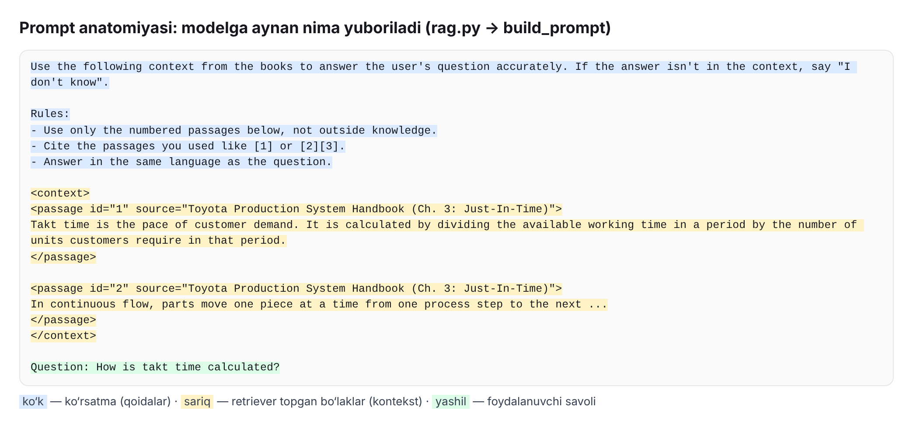

Promptning har bir qismi o‘z vazifasini bajaradi:

| Qism | Matn | Nima uchun |
|---|---|---|
| 🔵 Asosiy ko‘rsatma | “Use the following context… If the answer isn't in the context, say "I don't know"” | Modelni **faqat** berilgan bo‘laklarga tayanishga majburlaydi — gallyutsinatsiyaga qarshi |
| 🔵 Havola qoidasi | “Cite the passages you used like [1]” | Har bir da’voni manbadan tekshirish imkoni |
| 🔵 Til qoidasi | “Answer in the same language as the question” | O‘zbekcha savolga o‘zbekcha javob |
| 🟡 Kontekst | `<passage id="1" source="…">…</passage>` | Retriever topgan bo‘laklar, raqamlangan va manbasi bilan |
| 🟢 Savol | `Question: …` | Foydalanuvchining asl savoli |

**Nega “I don't know”?** Agar bo‘laklarda javob bo‘lmasa, model to‘qib chiqarmasdan **ochiq aytishi** kerak. Noto‘g‘ri javobdan “bilmayman” yaxshiroq.

Bu yondashuv **grounding** (javobni manbaga “bog‘lash”) deb ataladi.

📁 Loyihada: `toyota_rag/rag.py → PROMPT_TEMPLATE, build_prompt()`.

---

## 11. Generatsiya — javob yozish

RAG’ning **“G”** qismi: prompt LLM’ga yuboriladi va u javob yozadi.

Loyihadagi sozlamalar:

| Sozlama | Qiymat | Ma’nosi |
|---|---|---|
| `model` | `google/gemma-4-31b-it:free` | Javob yozuvchi model |
| `temperature` | `0.2` | “Ijodkorlik” darajasi: 0 — eng ehtimolli so‘zlar, aniq va barqaror; 1+ — xilma-xil, lekin xato ehtimoli yuqori. Faktlarga asoslangan javob uchun past qiymat yaxshi |
| `max_tokens` | `1024` | Javobning eng katta uzunligi (≈ 700 so‘z) |
| `messages` | `[{"role": "user", "content": prompt}]` | Chat formatidagi xabar. Ko‘rsatmalar `user` xabariga yozilgan, chunki ba’zi bepul provayderlar `system` xabarini qo‘llab-quvvatlamaydi |

**Fallback (zaxira model).** Bepul modellar ba’zan band bo‘ladi. Shunda kod avtomatik keyingi modelga o‘tadi:

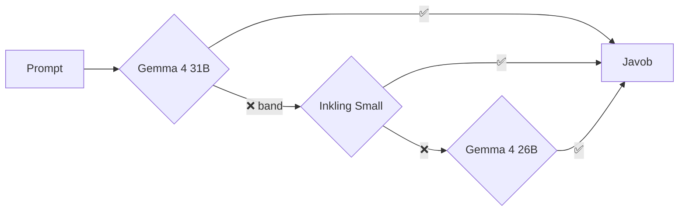

**O‘xshatish:** do‘stingizga qo‘ng‘iroq qildingiz, u ko‘tarmadi — boshqa do‘stingizga qo‘ng‘iroq qilasiz.

📁 Loyihada: `toyota_rag/rag.py → generate()`, `.env` da: `CHAT_MODELS=…`.

---

## 12. API, OpenRouter va bepul limitlar

**API** (Application Programming Interface) — bir dastur boshqa dasturdan xizmat so‘rashi uchun kelishilgan “til”. **O‘xshatish — restoran:** siz oshxonaga kirmaysiz, ofitsiantga (API) buyurtma berasiz, u taomni olib keladi.

**OpenRouter** — ko‘plab AI modellarini **bitta API** orqali beradigan xizmat. Bizning loyiha unga ikki xil so‘rov yuboradi:

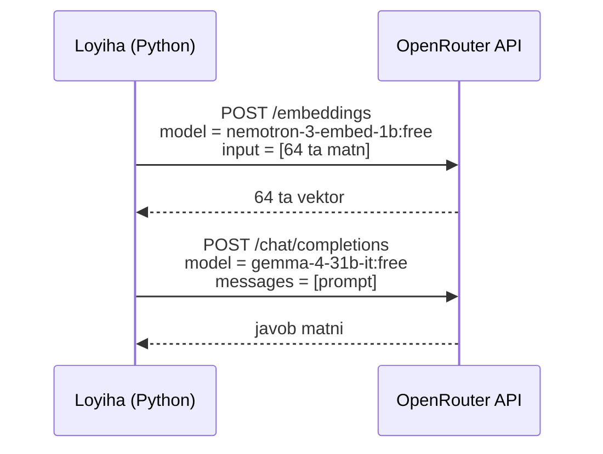

| Tushuncha | Ma’nosi |
|---|---|
| **API kaliti** (`OPENROUTER_API_KEY`) | Shaxsiy “parol”: OpenRouter so‘rov kimdan kelganini shu orqali biladi. Uni `.env` faylida saqlang va hech kimga bermang, GitHub’ga ham yuklamang (`.gitignore` buni oldini oladi) |
| **`:free` modellar** | Narxi $0, lekin cheklangan: daqiqasiga 20 ta, kuniga 50 ta so‘rov (10$ kredit kiritilsa — kuniga 1000 ta) |
| **Rate limit (429 xatosi)** | Limitdan oshsangiz, server “sekinroq” deydi |
| **Retry + backoff** | Kod 5, 10, 20 soniya kutib, qayta urinadi (har safar kutish vaqti ikki barobar oshadi) |
| **Batching** | 64 ta matnni bitta so‘rovda yuborish. 600 bo‘lak 600 ta emas, atigi 10 ta so‘rov bo‘ladi |
| **OpenAI-mos API** | OpenRouter OpenAI bilan bir xil formatda ishlaydi, shuning uchun oddiy `openai` Python paketidan `base_url` ni o‘zgartirib foydalanamiz |

📁 Loyihada: `toyota_rag/config.py → get_client()`, `toyota_rag/embeddings.py → call_with_retry()`.

---

## 13. Sifatni o‘lchash: hit@k va MRR

“Tizim yaxshi ishlayaptimi?” degan savolga **son** bilan javob berish kerak. Buning uchun javobi ma’lum bo‘lgan savollar to‘plami tuziladi (`eval/questions.json`) va retriever tekshiriladi.

* **hit@k** — to‘g‘ri bo‘lak **eng yaxshi k ta natija ichida** bo‘lgan savollar ulushi.
* **MRR** (Mean Reciprocal Rank) — to‘g‘ri bo‘lak **nechanchi o‘rinda** turganini hisobga oladi: 1-o‘rin = 1 ball, 2-o‘rin = ½, 3-o‘rin = ⅓, topilmasa = 0. So‘ng o‘rtachasi olinadi.

**Misol** (k = 4, uchta savol):

| Savol | To‘g‘ri bo‘lak nechanchi o‘rinda | hit@4 | 1 / o‘rin |
|---|---|---|---|
| “What is kanban?” | 1-o‘rin | ✅ | 1 |
| “Who founded Toyota?” | 3-o‘rin | ✅ | 1/3 ≈ 0.333 |
| “What is a P-valve?” | topilmadi | ❌ | 0 |
| **Natija** | | **2 / 3 ≈ 67%** | **(1 + 0.333 + 0) / 3 ≈ 0.444** |

**O‘xshatish:** hit@k — “kerakli kitob ko‘rsatilgan javonda bormi?”. MRR — “u javonning eng boshidami yoki oxiridami?”.

```bash
python evaluate.py -v   # har bir savol uchun OK/MISS va o‘rnini ko‘rsatadi
```

**PCA va embedding xaritasi.** Yuzlab o‘lchamli vektorlarni ko‘rib bo‘lmaydi. **PCA** usuli ularni “soyasini tushirib” 2 o‘lchamga keltiradi. Ma’lumot bir oz yo‘qoladi, lekin umumiy manzara ko‘rinadi. `python visualize.py --embeddings` haqiqiy vektorlaringizni shunday chizadi: yaxshi embedding’da bir kitobning bo‘laklari bir joyga to‘planadi.

---

## 14. Veb-sayt tushunchalari

Saytni tushunish uchun kerak bo‘ladigan asosiy so‘zlar:

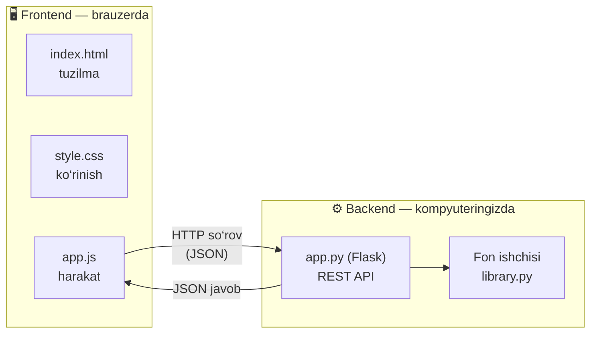

| Tushuncha | Oddiy tushuntirish | Loyihada |
|---|---|---|
| **Frontend** | Foydalanuvchi ko‘radigan qism: tugmalar, ro‘yxatlar | `templates/index.html`, `static/style.css`, `static/app.js` |
| **Backend** | Ko‘rinmaydigan, “oshxona” qismi: fayllarni qayta ishlash, qidiruv | `app.py`, `toyota_rag/` |
| **Flask** | Python’da veb-server yozish uchun kichik kutubxona | `app.py` |
| **HTTP so‘rov turlari** | `GET` — olish, `POST` — yuborish yoki yaratish, `DELETE` — o‘chirish | `GET /api/books`, `POST /api/ask`, `DELETE /api/books/<id>` |
| **JSON** | Ma’lumot almashish uchun matn formati: `{"question": "…", "k": 4}` | Barcha API javoblari |
| **Status kodlari** | `200` — OK, `202` — qabul qilindi (keyin bajariladi), `400` — so‘rov noto‘g‘ri, `404` — topilmadi, `409` — hozir bajarib bo‘lmaydi, `413` — fayl juda katta | `app.py` |
| **Fon ishchisi (background worker)** | Uzoq ishni alohida bajaradigan “yordamchi”. Sayt qotib qolmaydi | `library.py → ThreadPoolExecutor(max_workers=1)` |
| **Navbat (queue)** | Kitoblar birin-ketin qayta ishlanadi — bepul limit oshmaydi | `queued → extracting → embedding → ready` |
| **Polling** | Brauzer har 1,5 soniyada “tayyor bo‘ldimi?” deb so‘rab turadi | `app.js → loadBooks()` |
| **SHA-256 xesh** | Fayl mazmunidan olinadigan noyob “barmoq izi”. Bir xil fayl → bir xil xesh, shuning uchun ikki marta yuklangan kitob takrorlanmaydi | `library.py → add()` |
| **Fayl imzosi** | Faylning birinchi baytlari: PDF `%PDF` bilan, DOCX `PK` bilan boshlanadi. Nomi o‘zgartirilgan fayl aniqlanadi | `library.py → FILE_SIGNATURES` |
| **XSS** | Sahifaga begona skript joylash hujumi. Kitob matni faqat `textContent` orqali chiqariladi, shuning uchun kitob ichidagi `<script>` ishga tushmaydi | `app.js` |

**O‘xshatish — restoran (yana):** frontend — zal va menyu, backend — oshxona, API — ofitsiant, fon ishchisi — oshpaz. Oshpaz taom tayyorlayotganda ofitsiant sizni kutib turishga majburlamaydi, “buyurtmangiz qabul qilindi” (`202`) deydi.

---

## 15. Hammasi birga: real misol

Tasavvur qiling: siz 200 betlik PDF kitob yuklaysiz va “How is takt time calculated?” deb so‘raysiz.

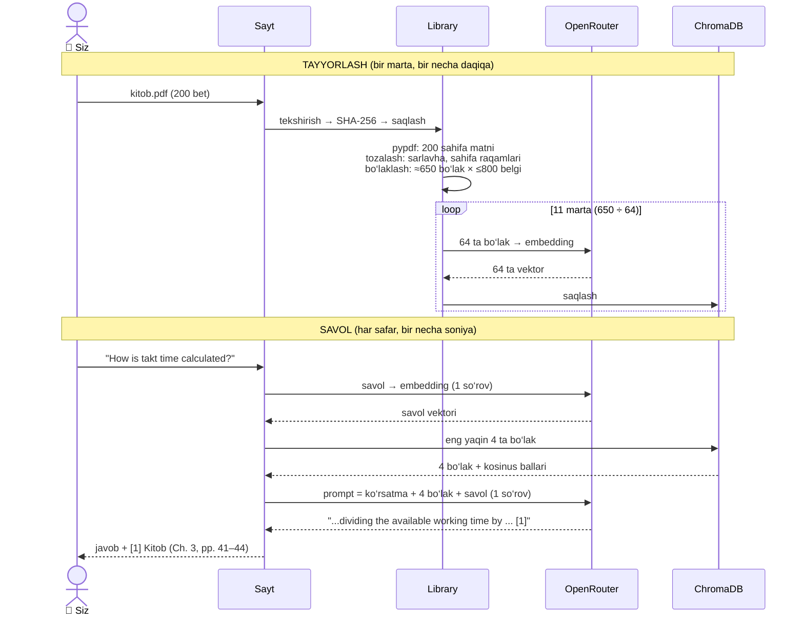

Raqamlar bilan:

| Bosqich | Kirish | Chiqish | API so‘rovlari |
|---|---|---|---|
| Matn ajratish | 200 betlik PDF | ≈300 000 belgi matn (≈1 500 belgi/bet) | 0 |
| Bo‘laklash | ≈300 000 belgi | ≈650 bo‘lak (har biri ≤ 800 belgi; overlap tufayli har bo‘lak ≈450 yangi belgi qo‘shadi) | 0 |
| Embedding | 650 bo‘lak | 650 ta vektor | 11 (64 tadan) |
| Savol embeddingi | 1 savol | 1 vektor | 1 |
| Retriever | 1 vektor + 650 vektor | eng yaqin 4 ta bo‘lak | 0 |
| Generatsiya | prompt (≈4 bo‘lak + savol) | javob + havolalar | 1 |

*Belgilar va bo‘laklar soni taxminiy — kitobga qarab o‘zgaradi. Aniq sonlarni saytdagi ℹ️ oynasi ko‘rsatadi.*

---

## 16. O‘zingizni tekshiring

<details>
<summary><b>1. Nega butun kitobni bitta bo‘lak qilib saqlamaymiz?</b></summary>

Bitta vektor butun kitobning o‘nlab mavzularini aniq ifodalay olmaydi — ma’no “aralashib” ketadi. Qidiruv aniq fikrni topa olmaydi, prompt esa to‘lib ketadi. Kichik bo‘laklar aniqroq topiladi va modelga faqat kerakli qismi beriladi.
</details>

<details>
<summary><b>2. Overlap 0 bo‘lsa, nima yomon bo‘ladi?</b></summary>

Bo‘lak chegarasida kontekst yo‘qoladi. Masalan, bo‘lak “For example, …” bilan boshlanib, nimaga misol ekanini aytmaydi. Retriever bo‘laklarni alohida topgani uchun, har bir bo‘lak o‘zicha tushunarli bo‘lishi kerak.
</details>

<details>
<summary><b>3. Embedding va oddiy kalit so‘z qidiruvining farqi nima?</b></summary>

Kalit so‘z qidiruvi faqat aynan shu so‘z bor joyni topadi. Embedding esa **ma’no** bo‘yicha topadi: “car” so‘raganda “automobile” yozilgan bo‘lakni ham topadi.
</details>

<details>
<summary><b>4. cos = 0.95 va cos = 0.10 — qaysi bo‘lak savolga yaqinroq?</b></summary>

0.95 — burchak kichik, ma’no juda yaqin. 0.10 — deyarli bog‘liq emas.
</details>

<details>
<summary><b>5. Embedding modelini almashtirsak, nega bazani qaytadan qurish kerak?</b></summary>

Har bir model o‘zining “ma’no xaritasi”ni yaratadi. Eski bo‘laklar bir xaritada, yangi savol boshqa xaritada bo‘lib qoladi. Ularning koordinatalarini solishtirish ma’nosiz. Ko‘pincha vektor o‘lchami ham boshqacha bo‘ladi.
</details>

<details>
<summary><b>6. Promptda “If the answer isn't in the context, say I don't know” qatori nima uchun kerak?</b></summary>

Gallyutsinatsiyaning oldini olish uchun. Topilgan bo‘laklarda javob bo‘lmasa, model to‘qib chiqarmasdan “bilmayman” deydi.
</details>

<details>
<summary><b>7. k = 1 va k = 20 — qaysi biri yaxshiroq?</b></summary>

Hech qaysisi. k = 1 da to‘g‘ri bo‘lak topilmay qolishi mumkin. k = 20 da promptga ko‘p shovqin tushadi. Odatda 3–6 eng yaxshi natija beradi.
</details>

<details>
<summary><b>8. Uch savoldan to‘g‘ri bo‘lak 2-o‘rinda, 1-o‘rinda va topilmadi. hit@4 va MRR qancha?</b></summary>

hit@4 = 2/3 ≈ 67%. MRR = (½ + 1 + 0) / 3 = 0.5.
</details>

<details>
<summary><b>9. Nega sayt kitobni darhol emas, fon ishchisida qayta ishlaydi?</b></summary>

Katta kitobni vektorga aylantirish bir necha daqiqa davom etadi. So‘rov ichida bajarilsa, brauzer qotib qoladi. Server faylni qabul qilib `202` qaytaradi, ishni esa fon ishchisi bajaradi. Brauzer har 1,5 soniyada holatni so‘rab turadi.
</details>

<details>
<summary><b>10. RAG’dagi R, A va G harflari loyihaning qaysi funksiyalariga mos keladi?</b></summary>

R — `retrieve()` (eng yaqin bo‘laklarni topish), A — `build_prompt()` (bo‘laklarni savolga qo‘shish), G — `generate()` (LLM javob yozadi). Uchalasi ham `toyota_rag/rag.py` da.
</details>

---

## 17. Qisqa lug‘at

| Atama | Bir jumlada |
|---|---|
| **API** | Dasturlar bir-biridan xizmat so‘rashi uchun kelishilgan “til” |
| **API kaliti** | Xizmatga kirish uchun shaxsiy parol (`OPENROUTER_API_KEY`) |
| **Batching** | Ko‘p matnni bitta so‘rovda yuborish |
| **Chunk (bo‘lak)** | Kitob matnining ≈800 belgilik mustaqil qismi |
| **Chunk overlap** | Qo‘shni bo‘laklarning umumiy qismi (≈150 belgi) |
| **ChromaDB** | Loyihamizdagi vektor bazasi |
| **Cleaning (tozalash)** | Sarlavha, sahifa raqami va boshqa “axlat”ni olib tashlash |
| **Embedding** | Matn ma’nosini sonlar ro‘yxati (vektor) ko‘rinishida ifodalash |
| **Extraction** | PDF yoki DOCX’dan oddiy matnni ajratib olish |
| **Fallback** | Asosiy model ishlamasa, zaxira modelga o‘tish |
| **Gallyutsinatsiya** | Modelning ishonch bilan noto‘g‘ri ma’lumot o‘ylab topishi |
| **Generation** | LLM’ning javob yozishi (RAG’dagi G) |
| **Grounding** | Javobni berilgan manbaga bog‘lash |
| **hit@k** | To‘g‘ri bo‘lak top-k ichida bo‘lgan savollar ulushi |
| **HNSW** | Vektorlar ichidan eng yaqinlarini tez topish algoritmi |
| **Kontekst oynasi** | Model bir martada ko‘ra oladigan tokenlar soni |
| **Kosinus o‘xshashligi** | Ikki vektor orasidagi burchakka asoslangan yaqinlik (−1…1) |
| **LLM** | Katta til modeli — matn yozadigan AI |
| **Metadata** | Bo‘lak haqidagi ma’lumot: kitob, bob, sahifa |
| **MRR** | To‘g‘ri bo‘lak o‘rnining teskari qiymatlari o‘rtachasi |
| **OpenRouter** | Ko‘p AI modellarini bitta API orqali beradigan xizmat |
| **PCA** | Ko‘p o‘lchamli vektorlarni 2D rasmga tushirish usuli |
| **Prompt** | Modelga yuboriladigan to‘liq matn: ko‘rsatma + kontekst + savol |
| **RAG** | Retrieval-Augmented Generation — avval qidirib, keyin javob yozish |
| **Rate limit** | Vaqt birligida yuborish mumkin bo‘lgan so‘rovlar chegarasi |
| **Retriever** | Savolga eng mos k ta bo‘lakni topuvchi qism (RAG’dagi R) |
| **Temperature** | Javobdagi tasodifiylik darajasi (bizda 0.2 — aniq) |
| **Token** | Model o‘qiydigan matn birligi (≈4 belgi) |
| **Top-k** | Eng yaqin k ta natija (bizda k = 4) |
| **Vektor** | Sonlar ro‘yxati, masalan `[0.12, −0.48, 0.91, …]` |
| **Vektor bazasi** | Vektorlarni saqlab, eng yaqinlarini tez topadigan baza |
