# 📚 Kitob RAG — PDF, Word va Markdown kitoblar bilan suhbat (Toyota misolida)

Bu loyiha — **RAG** (Retrieval-Augmented Generation — qidiruv bilan boyitilgan generatsiya) tizimi va uning **veb-sayti**. Foydalanuvchi o‘z kitobini (**PDF, DOCX, Markdown** yoki TXT) saytga yuklaydi. Tizim undan matnni ajratib oladi, bo‘laklarga bo‘ladi, vektorga aylantiradi, so‘ng savollarga **kitobdan iqtibos keltirib** javob beradi.

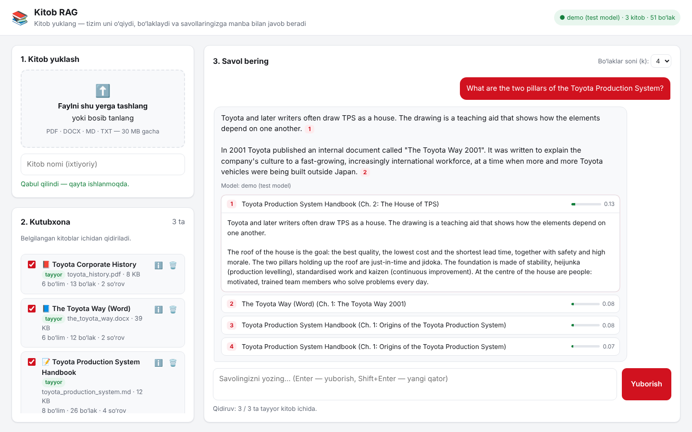

> 🎓 **Yangi boshlovchimisiz?** Chunk, overlap, embedding, retriever, RAG va boshqa tushunchalar rasmlar bilan oddiy tilda [I_EXPLAIN.md](I_EXPLAIN.md) faylida tushuntirilgan.

Tizim istalgan mavzudagi kitob bilan ishlaydi. Namuna sifatida **Toyota** mavzusi olingan: Toyota ishlab chiqarish tizimi (TPS), “The Toyota Way” tamoyillari, kompaniya tarixi va gibrid texnologiyalar.

Toyota manbalari internetdan **Python yordamida yuklab olinadi**: Toyota’ning rasmiy PDF hisoboti, Toyota’ning rasmiy veb-sahifasi va 10 ta Wikipedia maqolasi (to‘liq ro‘yxat — [Manbalar](#15-manbalar) bo‘limida). Ularni bitta buyruq bilan kutubxonaga qo‘shish mumkin.

Loyihada **pullik API kaliti kerak emas**. Barcha modellar [OpenRouter](https://openrouter.ai) orqali **bepul** ishlaydi:

| Vazifa | Model | Narxi |
|---|---|---|
| Matnni vektorga aylantirish (embedding) | `nvidia/nemotron-3-embed-1b:free` | $0 |
| Javob yozish (asosiy model) | `google/gemma-4-31b-it:free` | $0 |
| Zaxira model №1 | `thinkingmachines/inkling-small:free` | $0 |
| Zaxira model №2 | `google/gemma-4-26b-a4b-it:free` | $0 |

---

## 📑 Mundarija

1. [RAG nima va u nima uchun kerak?](#1-rag-nima-va-u-nima-uchun-kerak)
2. [Umumiy arxitektura](#2-umumiy-arxitektura)
3. [Veb-sayt: kitob yuklash va suhbat](#3-veb-sayt-kitob-yuklash-va-suhbat)
4. [Loyiha tuzilmasi](#4-loyiha-tuzilmasi)
5. [1-bosqich: Ma’lumotlarni yuklash va tozalash](#5-1-bosqich-malumotlarni-yuklash-va-tozalash)
6. [2-bosqich: Bo‘laklarga ajratish (chunking) va overlap](#6-2-bosqich-bolaklarga-ajratish-chunking-va-overlap)
7. [3-bosqich: Embedding — matnni vektorga aylantirish](#7-3-bosqich-embedding--matnni-vektorga-aylantirish)
8. [4-bosqich: ChromaDB vektor bazasi](#8-4-bosqich-chromadb-vektor-bazasi)
9. [5-bosqich: Qidiruv va javob generatsiyasi](#9-5-bosqich-qidiruv-va-javob-generatsiyasi)
10. [O‘rnatish va ishga tushirish](#10-ornatish-va-ishga-tushirish)
11. [Sifatni baholash va vizualizatsiya](#11-sifatni-baholash-va-vizualizatsiya)
12. [Bepul limitlar](#12-bepul-limitlar)
13. [Muammolar va yechimlar](#13-muammolar-va-yechimlar)
14. [Atamalar lug‘ati](#14-atamalar-lugati)
15. [Manbalar](#15-manbalar)

---

## 1. RAG nima va u nima uchun kerak?

Oddiy til modeli (LLM) faqat o‘qitilgan paytdagi bilimiga tayanadi. U sizning kitoblaringizni bilmaydi, ba’zan esa ishonch bilan noto‘g‘ri javob beradi (bunga “gallyutsinatsiya” deyiladi).

**RAG** bu muammoni hal qiladi. Model javob yozishdan oldin tizim kitoblardan savolga eng mos parchalarni topib, ularni modelga “shpargalka” sifatida beradi. Model faqat shu parchalarga tayanib javob yozadi va manbani ko‘rsatadi.

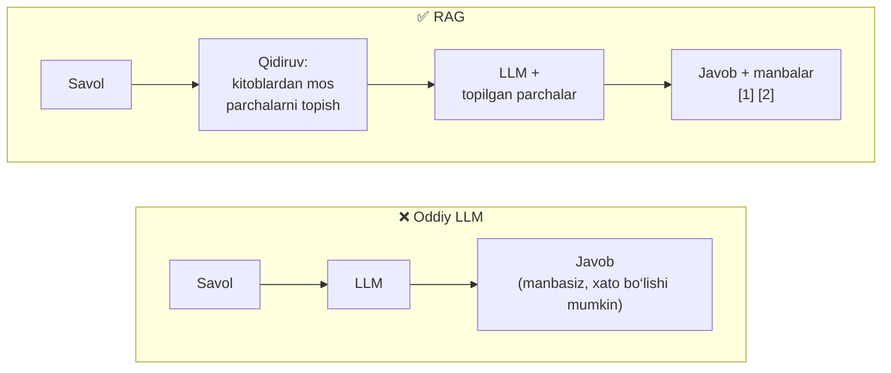

Bitta o‘xshatish: oddiy LLM — imtihonni yoddan topshirayotgan talaba, RAG — kitobni ochib, kerakli sahifani topib javob yozayotgan talaba.

---

## 2. Umumiy arxitektura

Tizim uch qatlamdan iborat:

* **Interfeyslar** — veb-sayt (`app.py` + brauzerdagi sahifa) va buyruq qatori (`ingest.py`, `query.py`). Ikkalasi ham bir xil yadrodan foydalanadi.
* **Yadro** (`toyota_rag/`) — kutubxona, matn ajratish, bo‘laklash, embedding, qidiruv va javob yozish.
* **Tashqi xizmatlar** — ChromaDB (kompyuteringizda, papkada) va OpenRouter’dagi bepul modellar (internetda).

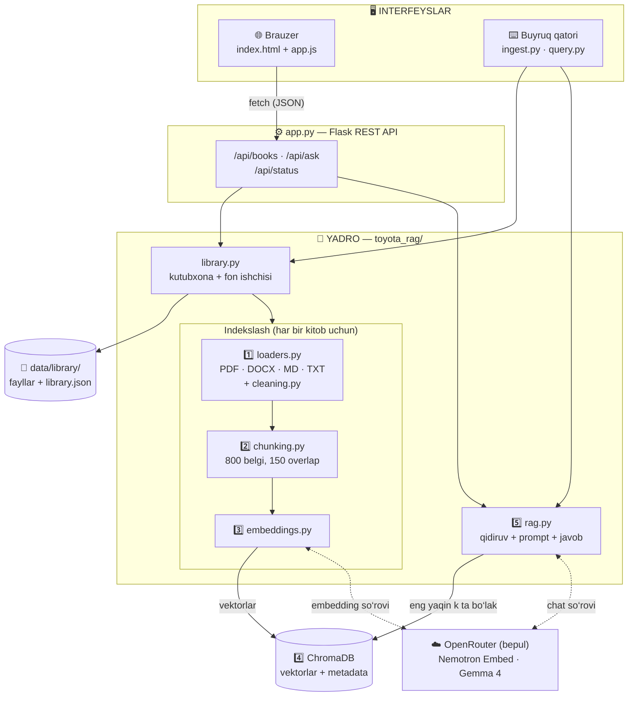

Ish ikki oqimga bo‘linadi:

* **Indekslash** — kitob yuklanganda bir marta bajariladi: matn ajratiladi, bo‘laklanadi, vektorga aylantiriladi va ChromaDB’ga saqlanadi.
* **Savol-javob** — har bir savol uchun bajariladi: savolga eng mos bo‘laklar topiladi va model shular asosida javob yozadi.

Har bir bosqich alohida faylda yozilgan:

| Bosqich | Fayl | Vazifasi |
|---|---|---|
| — | `toyota_rag/library.py` | Yuklangan kitoblarni qabul qilish, tekshirish, katalog, fon ishchisi (1–4-bosqichlarni boshqaradi) |
| 1 | `download_books.py`, `toyota_rag/loaders.py`, `toyota_rag/cleaning.py` | Manbalarni yuklab olish, PDF/DOCX/MD/TXT’dan matn ajratish, boblarga bo‘lish, tozalash |
| 2 | `toyota_rag/chunking.py` | Matnni overlap bilan bo‘laklarga bo‘lish, metadata qo‘shish |
| 3 | `toyota_rag/embeddings.py` | OpenRouter orqali bo‘laklarni vektorga aylantirish |
| 4 | `toyota_rag/vectorstores.py` | Vektorlarni ChromaDB’da saqlash va qidirish |
| 5 | `toyota_rag/rag.py` | Qidiruv, prompt tuzish, bepul chat modeldan javob olish |
| Sayt | `app.py`, `templates/index.html`, `static/app.js`, `static/style.css` | REST API va brauzerdagi sahifa |

---

## 3. Veb-sayt: kitob yuklash va suhbat

```bash
python app.py        # so‘ng brauzerda oching: http://127.0.0.1:5000
```

Sayt uch qismdan iborat: **1. Kitob yuklash**, **2. Kutubxona** va **3. Savol bering**.

> 📷 Quyidagi skrinshotlar saytning haqiqiy kodi bilan olingan: fayllar brauzer orqali yuklangan, matn ajratish, bo‘laklash va qidiruv haqiqiy. Faqat internet bo‘lmagani uchun OpenRouter modellari o‘rniga **test modellari** ishlatilgan (yuqori o‘ng burchakda `demo (test model)` deb yozilgan). Shuning uchun javob matni passajlardan ko‘chirilgan va o‘xshashlik ballari past. Haqiqiy ishga tushirishda javobni Gemma 4 yozadi.

### 3.1. Kitob yuklash va qayta ishlash

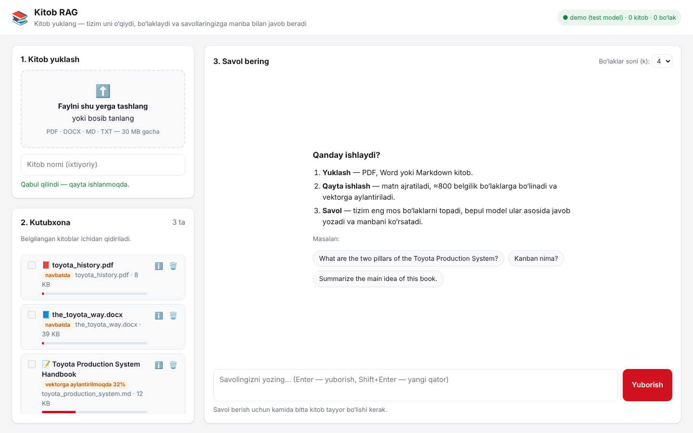

1. Faylni **sudrab tashlang** yoki bosib tanlang. Bir vaqtda bir nechta fayl yuklash mumkin.
2. Xohlasangiz, **kitob nomini** yozing. Aks holda nom fayl ichidan (PDF/DOCX xususiyatlari, Markdown `title:`) yoki fayl nomidan olinadi.
3. Har bir kitob kutubxonada **holat belgisi** va **progress chizig‘i** bilan ko‘rinadi: `navbatda` → `matn ajratilmoqda` → `vektorga aylantirilmoqda 32%` → `tayyor`.
4. Tayyor bo‘lgach, kitob kartasida bo‘limlar, bo‘laklar va sarflangan API so‘rovlari soni chiqadi.

Kitob qanday qayta ishlanadi:

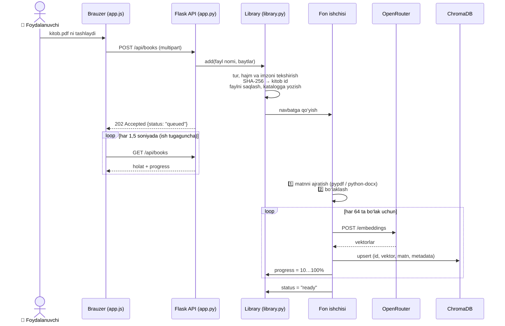

**Nega fon ishchisi (background worker)?** Katta kitobni vektorga aylantirish bir necha daqiqa davom etishi mumkin. Agar bu ish so‘rov ichida bajarilsa, brauzer “qotib” qoladi. Shuning uchun server faylni qabul qiladi, darhol `202 Accepted` qaytaradi, ishni esa alohida oqim bajaradi. Ishchi **bitta**: kitoblar navbat bilan qayta ishlanadi, shuning uchun OpenRouter’ning daqiqalik limiti (20 so‘rov) oshib ketmaydi.

Kitob holatlari:

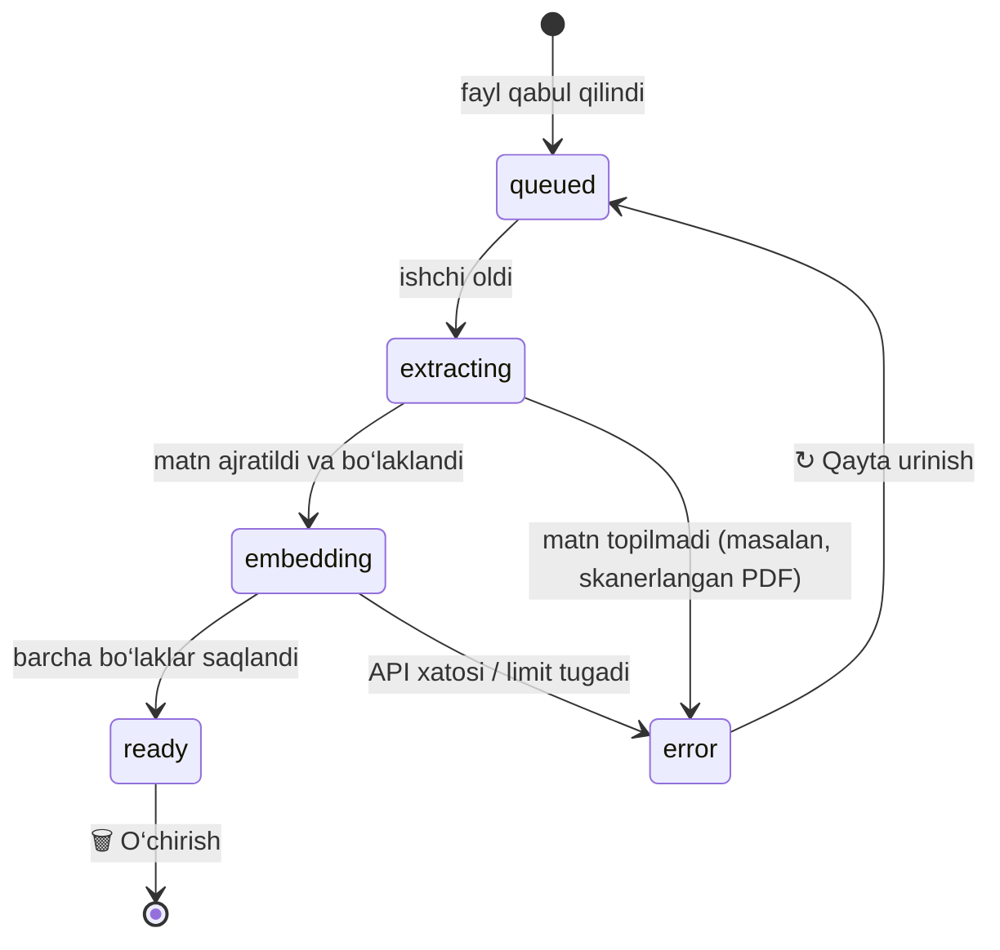

* **Qayta urinish arzon.** Masalan, so‘rovlar limiti tugab, xato chiqsa, ↻ tugmasini bosing. Allaqachon saqlangan bo‘laklar qayta vektorga aylantirilmaydi, faqat qolganlari yuboriladi.
* **Server qayta ishga tushsa ham ish yo‘qolmaydi.** `library.json` da holati `queued`/`extracting`/`embedding` bo‘lib qolgan kitoblar avtomatik qayta navbatga qo‘yiladi.
* **Bir xil faylni ikki marta yuklasangiz,** u takrorlanmaydi. Kitob id’si fayl mazmunining SHA-256 xeshidan olinadi.

### 3.2. Savol berish


* Kutubxonadagi **belgilangan (☑) kitoblar ichidan** qidiriladi. Belgini olib tashlasangiz, o‘sha kitob qidiruvga kirmaydi. Sahifa pastida “Qidiruv: 3 / 3 ta tayyor kitob ichida” deb ko‘rsatiladi.
* **k** — nechta bo‘lak topilishi (2–8). Ko‘proq bo‘lak — ko‘proq kontekst, lekin promptga ko‘proq “shovqin” ham tushadi.
* Javobdagi **[1]**, **[2]** belgilarini bosing — mos manba ochiladi: kitob, bob yoki sahifa, o‘xshashlik bali va bo‘lakning to‘liq matni.
* Javob qaysi modeldan kelgani ko‘rsatiladi (asosiy model band bo‘lsa, zaxira model javob beradi).

### 3.3. Kitob tafsilotlari

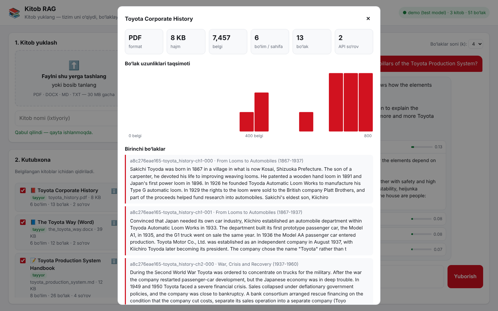

ℹ️ tugmasi kitob haqidagi statistikani ochadi: format, hajm, belgilar, bo‘limlar, bo‘laklar, sarflangan API so‘rovlari, **bo‘lak uzunliklari gistogrammasi** va birinchi 3 ta bo‘lak. Bu oynada ajratish va bo‘laklash qanday o‘tganini ko‘z bilan tekshirish mumkin. Masalan, yuqoridagi PDF’da har sahifadagi `TOYOTA CORPORATE HISTORY` sarlavhasi va sahifa raqamlari olib tashlangan, matn esa “Chapter N” sarlavhalari bo‘yicha 6 bo‘limga ajratilgan.

Sayt telefon ekraniga ham moslashadi, shuningdek tizimning qorong‘i rejimini qo‘llab-quvvatlaydi:

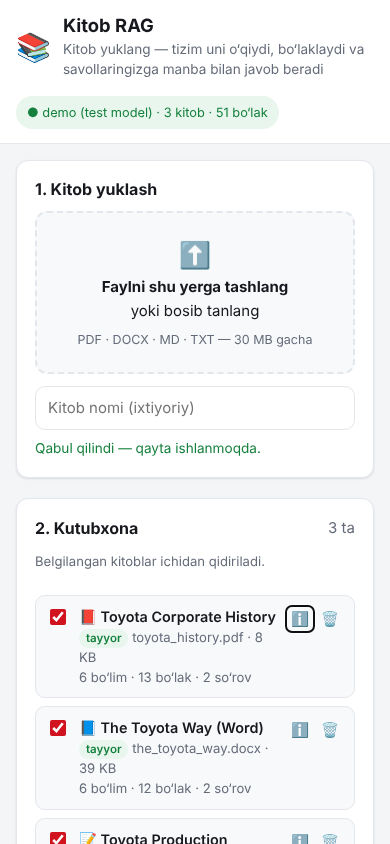

### 3.4. REST API

Sahifa server bilan JSON orqali gaplashadi. Shu API’ni boshqa dasturlardan (masalan, `curl`) ham ishlatish mumkin:

| Usul | Manzil | Vazifasi | Javob |
|---|---|---|---|
| `GET` | `/api/status` | Sozlamalar, API kaliti bormi, nechta kitob tayyor | `200` |
| `GET` | `/api/books` | Barcha kitoblar: holat, progress, statistika | `200` |
| `POST` | `/api/books` | Kitob yuklash (`file` maydoni, ixtiyoriy `title`) | `202` qabul qilindi, `400` noto‘g‘ri fayl |
| `GET` | `/api/books/<id>` | Bitta kitob: bo‘lak uzunliklari va birinchi bo‘laklar | `200` / `404` |
| `POST` | `/api/books/<id>/retry` | Xato bergan kitobni qayta ishlash | `202` |
| `DELETE` | `/api/books/<id>` | Kitobni, faylini va uning vektorlarini o‘chirish | `200` / `404` |
| `POST` | `/api/ask` | `{"question", "book_ids", "k"}` → javob + manbalar | `200`, `409` tayyor kitob yo‘q, `502` model xatosi |

```bash
curl -F "file=@kitob.pdf" -F "title=Mening kitobim" http://127.0.0.1:5000/api/books
curl -H "Content-Type: application/json" -d '{"question": "What is kanban?", "k": 4}' http://127.0.0.1:5000/api/ask
```

`/api/ask` javobi:

```json
{
  "answer": "Kanban is a scheduling system ... [1]",
  "model": "google/gemma-4-31b-it:free",
  "sources": [
    {"n": 1, "book": "Wikipedia: Kanban", "citation": "Wikipedia: Kanban (Ch. 1: Introduction)",
     "score": 0.71, "text": "...", "url": "https://en.wikipedia.org/wiki/Kanban", "book_id": "3fa1c2..."}
  ]
}
```

### 3.5. Xavfsizlik va tekshiruvlar

Saytga istalgan fayl yuklanishi mumkin, shuning uchun server har bir faylni tekshiradi:

| Tekshiruv | Nima uchun |
|---|---|
| Faqat `.pdf`, `.docx`, `.md`, `.txt` qabul qilinadi | Boshqa turdagi fayllar (`.exe` va h.k.) rad etiladi |
| Fayl “imzosi” tekshiriladi: PDF `%PDF` bilan, DOCX `PK` (zip) bilan boshlanishi kerak | Nomi o‘zgartirilgan fayl o‘tib ketmaydi |
| Hajm chegarasi `MAX_UPLOAD_MB` (standart 30 MB) | Server xotirasi to‘lib qolmaydi |
| Fayl diskka foydalanuvchi bergan nom bilan emas, `<sha256>.pdf` nomi bilan saqlanadi | `../../` kabi xavfli nomlar ishlamaydi |
| Brauzerda kitob va model matni faqat `textContent` orqali chiqariladi (`innerHTML` emas) | Kitob ichidagi `<script>` sahifada ishga tushmaydi (XSS himoyasi) |
| Savol uzunligi 2000 belgigacha, `k` 1–10 oralig‘ida | Juda katta so‘rovlar oldi olinadi |

> ⚠️ Sayt standart holatda faqat sizning kompyuteringizda (`127.0.0.1`) ochiladi. `--host 0.0.0.0` bilan tarmoqqa ochsangiz, unga parol yoki boshqa himoya qo‘shilmaganini yodda tuting.

---

## 4. Loyiha tuzilmasi

```text
toyota_rag_pipeline/
├── data/books/                    📚 Yuklab olingan manbalar (download_books.py yaratadi)
│   ├── toyota_integrated_report_2023.pdf
│   ├── toyota_official_tps_page.txt
│   ├── wikipedia_toyota_production_system.txt   … (jami 10 ta Wikipedia maqolasi)
│   └── sources.json               har bir fayl nomi, havolasi va litsenziyasi
├── data/library/                  📁 Saytga yuklangan kitoblar (avtomatik yaratiladi)
│   ├── files/<id>.pdf|docx|md     asl fayllar
│   └── library.json               katalog: nom, holat, progress, statistika
├── toyota_rag/                    🧠 Yadro
│   ├── config.py                  ⚙️ Barcha sozlamalar (.env dan o‘qiladi)
│   ├── library.py                 kutubxona: tekshirish, katalog, fon ishchisi
│   ├── loaders.py                 1-bosqich: PDF / DOCX / MD / TXT dan matn ajratish
│   ├── cleaning.py                1-bosqich: tozalash
│   ├── chunking.py                2-bosqich: bo‘laklash
│   ├── embeddings.py              3-bosqich: embedding
│   ├── vectorstores.py            4-bosqich: ChromaDB
│   └── rag.py                     5-bosqich: qidiruv + javob
├── app.py                         🌐 Veb-sayt (Flask REST API)
├── templates/index.html           sahifa
├── static/app.js, style.css       sahifa logikasi va dizayni
├── download_books.py              ▶️ Toyota manbalarini internetdan yuklab olish
├── ingest.py                      ▶️ Papkadagi kitoblarni kutubxonaga qo‘shish
├── query.py                       ▶️ Buyruq qatoridan savol berish
├── evaluate.py                    📊 Qidiruv sifatini o‘lchash
├── visualize.py                   🖼️ Grafiklar chizish
├── eval/questions.json            18 ta baholash savoli (haqiqiy manbalar bo‘yicha)
├── tests/
│   ├── test_pipeline.py           ✅ 34 ta avtomatik test (internet kerak emas)
│   └── fixtures/                  testlar uchun kichik namuna matnlar
├── docs/images/                   README’dagi rasmlar
├── I_EXPLAIN.md                   🎓 Tushunchalar — yangi boshlovchilar uchun
├── docs/explain/                  I_EXPLAIN.md rasmlari + make_figures.py
├── requirements.txt
└── .env.example                   API kaliti uchun namuna
```

**Ma’lumotlar haqida:** Toyota namunasi uchun asosiy ma’lumotlar — `download_books.py` internetdan yuklab oladigan haqiqiy manbalar ([15-bo‘lim](#15-manbalar)). Saytga esa istalgan kitobni yuklash mumkin. `tests/fixtures/` dagi kichik namuna matnlar faqat internetsiz ishlaydigan testlar uchun.

---

## 5. 1-bosqich: Ma’lumotlarni yuklash va tozalash

**Maqsad:** foydalanuvchi yuklagan yoki internetdan olingan fayldan toza matn ajratib olish va uni boblarga bo‘lish.

### 1a. Har bir format qanday o‘qiladi — `loaders.py`

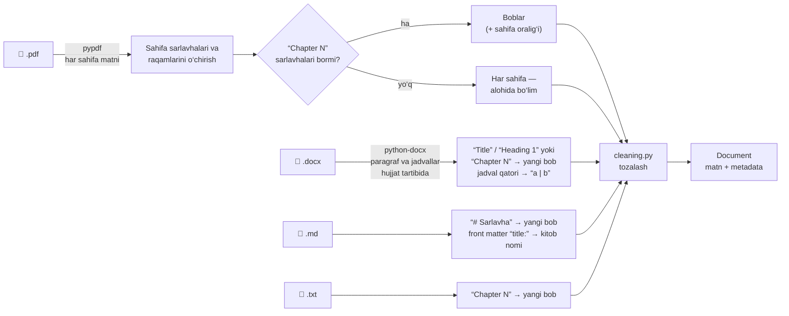

| Format | Kutubxona | Boblar qanday aniqlanadi | Kitob nomi qayerdan olinadi |
|---|---|---|---|
| **PDF** | `pypdf` | `Chapter 3: …` qatorlari; ular bo‘lmasa — har sahifa alohida (javobda `p. 14` ko‘rsatiladi) | PDF xususiyatlaridagi *Title* (`untitled` kabi bo‘sh nomlar e’tiborga olinmaydi) |
| **DOCX** | `python-docx` | `Title` yoki `Heading 1` uslubidagi paragraf, yoki `Chapter N` matni; `Heading 2–3` oddiy matn sifatida qoladi; jadvallar `katak | katak` qatorlariga aylanadi | Word xususiyatlaridagi *Title* |
| **Markdown** | — | Har bir `# Sarlavha`; birinchi sarlavhagacha bo‘lgan matn “Introduction” bo‘ladi | Front matter’dagi `title:` |
| **TXT** | — | `Chapter N` qatorlari | Fayl nomi |

Barcha holatlarda saytdagi “Kitob nomi” maydoniga yozilgan nom ustun turadi. Skanerlangan PDF’da matn qatlami bo‘lmaydi, shuning uchun kitob `xato` holatiga o‘tadi va “avval OCR qiling” degan xabar chiqadi.

### 1b. Toyota manbalarini yuklab olish — `download_books.py`

Uch xil manba uch xil Python usuli bilan qayta ishlanadi:

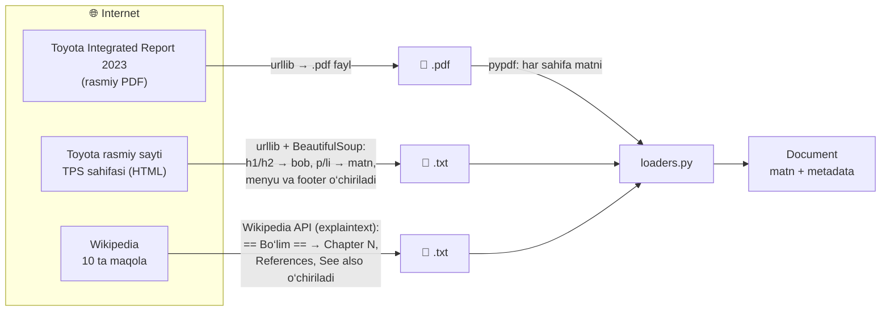

| Manba turi | Kutubxona | Nima qilinadi |
|---|---|---|
| PDF (Toyota hisoboti) | `urllib` → `pypdf` | Fayl yuklab olinadi, `pypdf` har bir sahifadan matnni ajratib oladi. Hisobotda “Chapter” sarlavhalari yo‘q, shuning uchun **har bir sahifa alohida bo‘lim** bo‘ladi va javobda sahifa raqami ko‘rsatiladi: `Toyota Integrated Report 2023 (p. 14)` |
| HTML (Toyota sayti) | `urllib` + `BeautifulSoup` | `<script>`, `<nav>`, `<footer>` kabi teglar o‘chiriladi; `h1/h2` — bob sarlavhasi, `p/li` — matn; 40 belgidan qisqa menyu yozuvlari tashlab yuboriladi |
| Wikipedia | Wikipedia API | Toza matn (`explaintext`) olinadi; `== Bo‘lim ==` sarlavhalari `Chapter N: Bo‘lim` ga aylanadi; “References”, “See also”, “External links” kabi havolalar ro‘yxati o‘chiriladi |

Har bir faylning haqiqiy nomi, havolasi va litsenziyasi `data/books/sources.json` ga yoziladi. Loader shu fayldan foydalanib, har bir bo‘lakka `source_book` va `source_url` qo‘shadi, shuning uchun javobdagi har bir manbani ochib tekshirish mumkin.

### 1c. Tozalash — `cleaning.py`

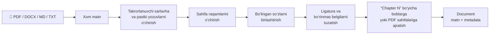

PDF’dan olingan matnda odatda ko‘p “axlat” bo‘ladi. `cleaning.py` ularni quyidagicha tozalaydi:

| Muammo | Tozalashdan oldin | Tozalashdan keyin |
|---|---|---|
| Sahifa raqami | `… kanban cards.`<br/>`17`<br/>`Next paragraph` | `… kanban cards.`<br/>`Next paragraph` |
| Har sahifadagi sarlavha | `THE TOYOTA WAY` (har sahifa tepasida) | o‘chiriladi |
| Qator oxirida bo‘lingan so‘z | `pro-`<br/>`duction` | `production` |
| Ligatura | `first` (bitta belgi) | `first` |
| Ko‘rinmas belgilar | soft hyphen, zero-width space | o‘chiriladi |

**Takrorlanuvchi sarlavhalarni qanday topadi?** Har bir sahifaning birinchi va oxirgi 2 qatori olinadi, ulardagi raqamlar `#` bilan almashtiriladi (shunda `Page 12` va `Page 13` bir xil bo‘lib qoladi). Sahifalarning kamida yarmida takrorlangan qator — sarlavha yoki pastki yozuv deb hisoblanib, o‘chiriladi.

Natijada har bir bob bitta `Document` obyektiga aylanadi:

```python
Document(
    text="Kanban is a scheduling system for lean manufacturing ...",
    metadata={
        "source_book": "Wikipedia: Kanban",
        "source_file": "wikipedia_kanban.txt",
        "source_url": "https://en.wikipedia.org/wiki/Kanban",
        "chapter": 1,
        "chapter_title": "Introduction",
        # PDF uchun yana: "page_start": 14, "page_end": 14
        # saytga yuklangan kitob uchun yana: "book_id": "3fa1c2d4e5b6"
    },
)
```

---

## 6. 2-bosqich: Bo‘laklarga ajratish (chunking) va overlap

**Nega bo‘laklash kerak?** Butun bobni bitta vektorga aylantirsak, uning ma’nosi “aralashib” ketadi va aniq javobni topish qiyinlashadi. Juda kichik bo‘laklarda esa kontekst yo‘qoladi. Shuning uchun matn **≈800 belgilik** bo‘laklarga bo‘linadi.

**Overlap nima?** Muhim fikr ikki bo‘lak chegarasiga to‘g‘ri kelib qolishi mumkin. Shuning uchun har bir yangi bo‘lak oldingi bo‘lakning oxirgi **≈150 belgisi** bilan boshlanadi. Shunda chegaradagi fikr ikkala bo‘lakda ham to‘liq saqlanadi.

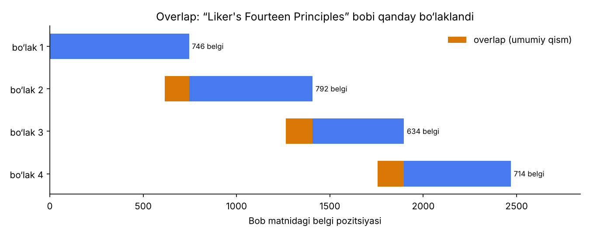

*Rasmda bitta bobning 4 ta bo‘lakka bo‘linishi ko‘rsatilgan. To‘q sariq qism — oldingi bo‘lak bilan umumiy matn (overlap).*

### Rekursiv bo‘laklash algoritmi

Matn tasodifiy joydan kesilmaydi. Algoritm avval eng “kuchli” chegaralardan foydalanishga harakat qiladi:

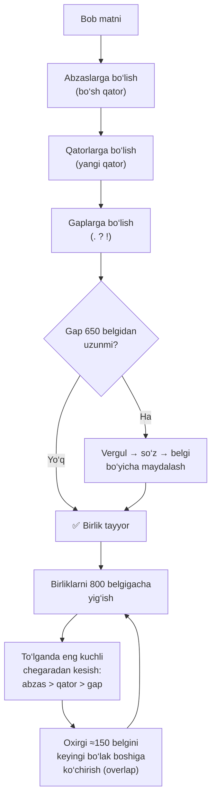

1. **Birliklarga ajratish.** Matn abzas → qator → gap tartibida bo‘linadi. Faqat juda uzun gaplar (650 belgidan ortiq) vergul, so‘z yoki belgilar bo‘yicha maydalanadi. Har bir birlik o‘zini qaysi ajratgich tugatganini eslab qoladi (abzas oxiri eng kuchli chegara).
2. **Yig‘ish.** Birliklar 800 belgigacha bitta bo‘lakka yig‘iladi. Bo‘lak to‘lganda u **kamida yarmi to‘lgan holda eng kuchli chegaradan** kesiladi: imkon bo‘lsa abzas oxiridan, bo‘lmasa gap oxiridan.
3. **Overlap.** Kesilgan bo‘lakning oxirgi ≈150 belgisi (iloji bo‘lsa butun gaplar) keyingi bo‘lakning boshiga qo‘shiladi.

> 💡 **Nega LangChain’ning `RecursiveCharacterTextSplitter`i ishlatilmadi?** Algoritm aynan shu g‘oyaga asoslangan, lekin LangChain overlap’ni faqat 150 belgidan qisqa bo‘laklar uchun qo‘sha oladi. Abzaslar odatda uzunroq bo‘lgani uchun namuna matnlarda qo‘shni bo‘laklarning atigi ~10 foizida overlap bor edi. Bizning `RecursiveOverlapSplitter` esa **har bir** qo‘shni bo‘lak juftligida overlap bo‘lishini kafolatlaydi (bu testlarda tekshiriladi). Qo‘shimcha kutubxona ham kerak emas.

### Natija

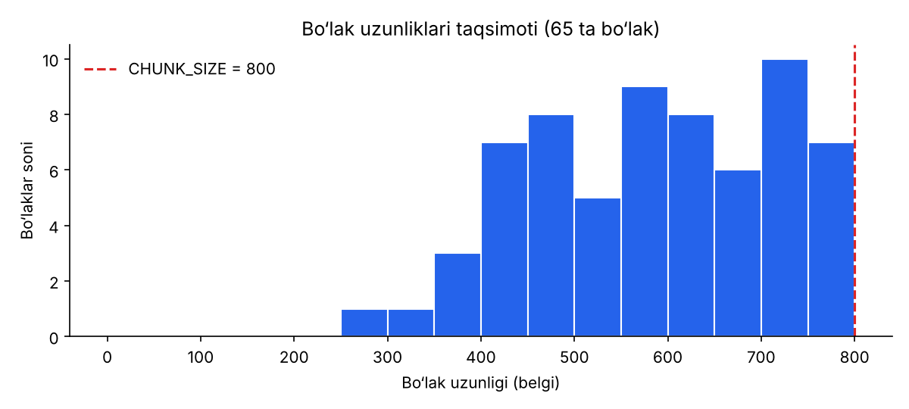

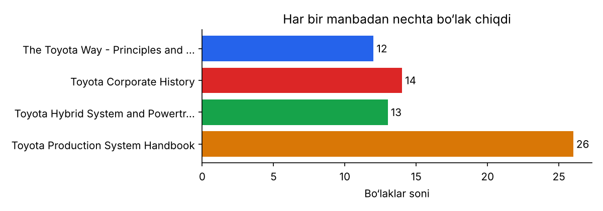

> 📊 Bu grafiklar `python visualize.py` buyrug‘i bilan `data/books/` dagi manbalardan yaratiladi. Manbalarni yuklab olgach, buyruqni qayta ishga tushiring — rasmlar sizning ma’lumotlaringiz bo‘yicha yangilanadi. Bo‘laklarning aniq soni va uzunliklarini `python ingest.py --dry-run` ham chiqarib beradi.

Hech bir bo‘lak 800 belgidan oshmaydi (bu testlarda tekshiriladi). Qisqa bo‘laklar — bob yoki sahifaning oxirgi qismlari.

Har bir bo‘lak o‘z metadatasi bilan saqlanadi:

```json
{
  "id": "wikipedia_hybrid_synergy_drive-ch2-000",
  "text": "... the power split device is a planetary gear set ...",
  "metadata": {
    "source_book": "Wikipedia: Hybrid Synergy Drive",
    "source_url": "https://en.wikipedia.org/wiki/Hybrid_Synergy_Drive",
    "chapter": 2,
    "chapter_title": "...",
    "chunk_index": 0,
    "char_count": 742
  }
}
```

`id` doimiy bo‘lgani uchun `ingest.py` ni qayta ishga tushirsangiz, bo‘laklar takrorlanmaydi, eskisi yangilanadi.

---

## 7. 3-bosqich: Embedding — matnni vektorga aylantirish

**Embedding** — matnning *ma’nosini* sonlar ro‘yxati (vektor) ko‘rinishida ifodalash. Embedding modeli shunday o‘qitilganki, **ma’nosi yaqin matnlarning vektorlari ham bir-biriga yaqin** bo‘ladi, hatto ularda bir xil so‘zlar bo‘lmasa ham.

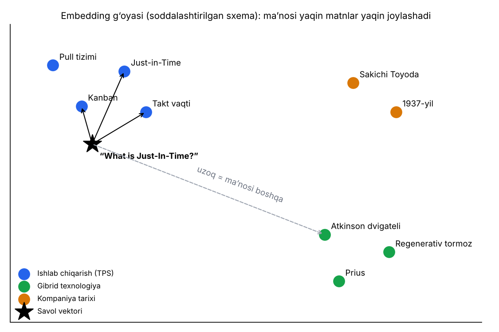

*Bu soddalashtirilgan sxema. Haqiqiy vektorlar 2 emas, yuzlab yoki minglab o‘lchamga ega. “What is Just-In-Time?” savoli kanban, takt vaqti kabi ishlab chiqarish mavzularidagi bo‘laklarga yaqin, gibrid dvigatel haqidagi bo‘laklardan esa uzoqda joylashadi.*

### Qanday ishlaydi

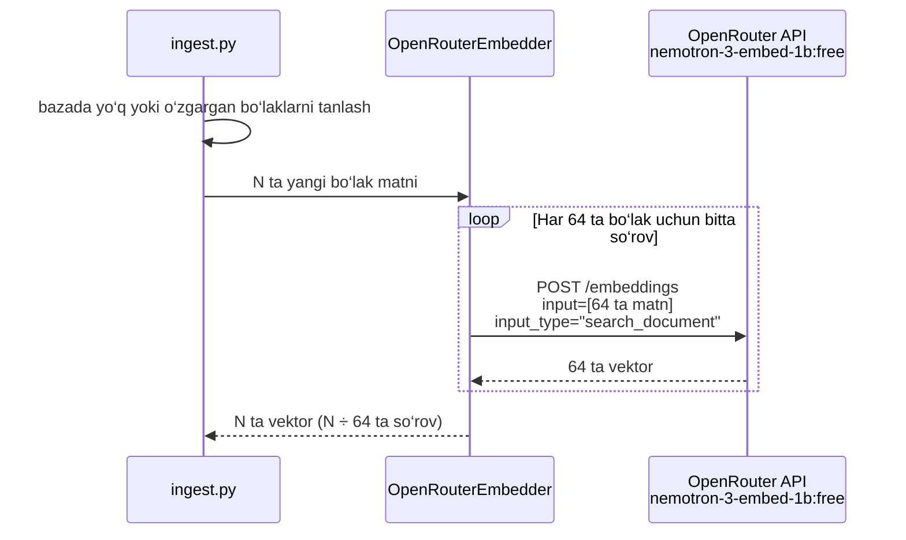

* **Model:** `nvidia/nemotron-3-embed-1b:free`. NVIDIA’ning qidiruv va RAG uchun moslashtirilgan bepul embedding modeli.
* **Paket bilan yuborish (batching):** har bir so‘rovda 64 ta matn yuboriladi. Masalan, 700 ta bo‘lak uchun atigi **11 ta so‘rov** ketadi. Bu bepul kunlik limitni tejaydi.
* **Faqat yangi bo‘laklar:** `ingest.py` qayta ishga tushirilsa, bazada allaqachon bor va o‘zgarmagan bo‘laklar qayta vektorga aylantirilmaydi — so‘rovlar sarflanmaydi.
* **`input_type`:** Nemotron savollarni (`search_query`) va hujjatlarni (`search_document`) biroz boshqacha kodlaydi. Bu qidiruv aniqligini oshiradi. Agar provayder bu parametrni qabul qilmasa, kod uni avtomatik olib tashlab, so‘rovni qaytadan yuboradi.
* **Sarlavha qo‘shish:** har bir bo‘lak vektorga aylantirishdan oldin `Kitob nomi - Bob nomi` sarlavhasi bilan boshlanadi. Chunki bo‘lakning o‘zida ko‘pincha mavzu nomi yozilmagan bo‘ladi. Bazada esa toza matn saqlanadi.
* **Qayta urinish:** bepul modellar band bo‘lsa (`429` xatosi), kod 5, 10, 20 soniya kutib, qayta urinadi.

OpenRouter OpenAI API bilan mos keladi. Shuning uchun alohida kutubxona kerak emas, oddiy `openai` paketining `base_url` parametri o‘zgartiriladi:

```python
from openai import OpenAI
client = OpenAI(base_url="https://openrouter.ai/api/v1", api_key=OPENROUTER_API_KEY)
client.embeddings.create(model="nvidia/nemotron-3-embed-1b:free", input=["...", "..."])
```

---

## 8. 4-bosqich: ChromaDB vektor bazasi

**Vektor bazasi** — vektorlarni saqlaydigan va “bu vektorga eng yaqin vektorlar qaysi?” degan savolga tez javob beradigan maxsus baza.

ChromaDB’dagi `toyota_books_collection` to‘plamida har bir bo‘lak uchun 4 narsa saqlanadi:

| Maydon | Misol | Nima uchun kerak |
|---|---|---|
| `id` | `toyota_production_system-ch3-001` | Bo‘lakni takrorlamasdan yangilash |
| `embedding` | `[0.021, -0.113, 0.087, …]` | O‘xshashlik bo‘yicha qidirish |
| `document` | “Takt time is the pace of customer demand…” | Modelga kontekst sifatida berish |
| `metadata` | `{source_book, chapter, chapter_title, …}` | Manbani ko‘rsatish, kitob bo‘yicha filtrlash |

### O‘xshashlik qanday o‘lchanadi — kosinus o‘xshashligi

Ikki vektor orasidagi burchak qancha kichik bo‘lsa, matnlarning ma’nosi shuncha yaqin:

$$
\text{o‘xshashlik}(q, d) = \cos\theta = \frac{q \cdot d}{\lVert q \rVert \, \lVert d \rVert}
$$

* **1.0** — ma’nosi bir xil
* **0** — bog‘liq emas
* Kod ChromaDB qaytargan “masofa”ni (`1 − cos θ`) o‘xshashlikka aylantirib ko‘rsatadi: `score = 1 − masofa`.

ChromaDB bu qidiruvni **HNSW** indeksi yordamida bajaradi. HNSW barcha vektorlarni birma-bir solishtirmaydi, “qo‘shnilar grafi” bo‘ylab tez yurib, eng yaqinlarini topadi.

### Nega Qdrant emas, ChromaDB?

Yo‘l xaritasida ikkala variant ham taklif qilingan. Bu o‘quv loyihasi uchun ChromaDB tanlandi:

| Mezon | ChromaDB ✅ | Qdrant |
|---|---|---|
| O‘rnatish | `pip install chromadb` — tamom | Ko‘pincha Docker’da alohida server |
| Ishlash tarzi | Python ichida, ma’lumotlar papkada | Rust’da yozilgan alohida xizmat |
| Kimga mos | Prototip, o‘quv loyihalari | Katta hajmli production tizimlar |
| Murakkab filtrlar | Oddiy filtrlar yetarli | Juda boy filtrlash imkoniyatlari |

Bizda bir necha yuz bo‘lak bor. Bunday hajm uchun ChromaDB bemalol yetarli va loyihani sodda saqlaydi.

---

## 9. 5-bosqich: Qidiruv va javob generatsiyasi

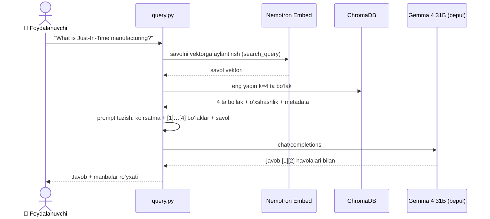

### Prompt

Modelga yuboriladigan matn (`rag.py` dagi `PROMPT_TEMPLATE`):

```text
Use the following context from Toyota books to answer the user's question accurately.
If the answer isn't in the context, say "I don't know".

Rules:
- Use only the numbered passages below, not outside knowledge.
- Cite the passages you used like [1] or [2][3].
- Answer in the same language as the question.

<context>
<passage id="1" source="Wikipedia: Just-in-time manufacturing (Ch. 1: Introduction)">
Just-in-time manufacturing is a methodology aimed primarily at reducing ...
</passage>
<passage id="2" source="...">
...
</passage>
</context>

Question: What is Just-In-Time manufacturing?
```

Bu promptning har bir qismi gallyutsinatsiyaga qarshi ishlaydi:

* **“Faqat parchalardan foydalan”** — model o‘z “xotirasidan” to‘qib chiqarmaydi.
* **“Bilmasang, I don’t know de”** — kontekstda javob bo‘lmasa, model buni ochiq aytadi.
* **`[1]`, `[2]` havolalari** — har bir da’voni manbadan tekshirish mumkin.
* **“Savol tilida javob ber”** — o‘zbekcha savolga o‘zbekcha javob qaytadi.

Ko‘rsatmalar `system` xabariga emas, `user` xabariga yozilgan, chunki ba’zi bepul provayderlar `system` xabarini qo‘llab-quvvatlamaydi.

### Zaxira modellar (fallback)

Bepul modellar ba’zan band yoki vaqtincha ishlamay qolishi mumkin. Shuning uchun `CHAT_MODELS` ro‘yxatidagi modellar navbat bilan sinab ko‘riladi:

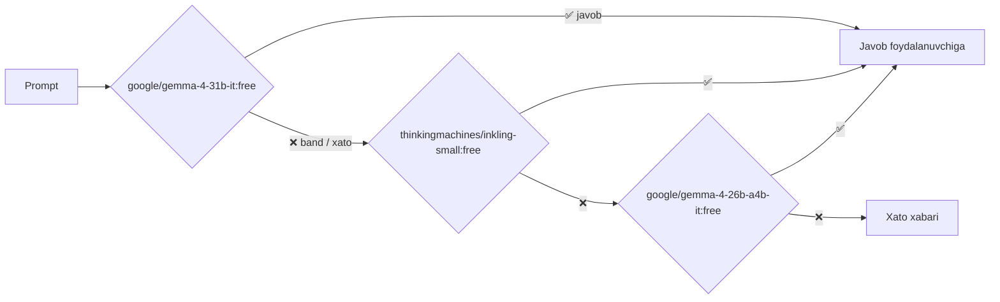

| Model | Nega tanlangan |
|---|---|
| **Gemma 4 31B** (asosiy) | Ko‘p tilli (140+ til), ko‘rsatmalarga yaxshi amal qiladi, 256K kontekst |
| **Inkling Small** | Tavsifida RAG va ko‘p tilli suhbat uchun mos ekani aytilgan, 1M kontekst |
| **Gemma 4 26B A4B** | Har bir token uchun faqat 3.8B parametr ishlaydi, shuning uchun tez |

Javob qaysi modeldan kelgani har doim ko‘rsatiladi: `Answer (google/gemma-4-31b-it:free):`.

---

## 10. O‘rnatish va ishga tushirish

### 1) Bepul OpenRouter kalitini olish

1. [openrouter.ai](https://openrouter.ai) saytida ro‘yxatdan o‘ting (pul to‘lash shart emas).
2. [openrouter.ai/keys](https://openrouter.ai/keys) sahifasida **Create Key** tugmasini bosing.
3. `sk-or-v1-...` bilan boshlanadigan kalitni nusxalang.

### 2) Loyihani o‘rnatish

```bash
cd ~/Generative_AI_Tasks/toyota_rag_pipeline
python3 -m venv .venv
source .venv/bin/activate          # Windows: .venv\Scripts\activate
pip install -r requirements.txt
cp .env.example .env               # so‘ng .env ichiga kalitingizni qo‘ying
```

### 3) Ishga tushirish

```bash
# Tekshiruv: internet va kalitsiz ishlaydi
python -m pytest -q                # 34 passed
```

**A) Veb-sayt orqali** — eng oson yo‘l:

```bash
python app.py                      # brauzerda: http://127.0.0.1:5000
```

Kitobni sahifaga tashlang, “tayyor” bo‘lishini kuting va savol bering ([3-bo‘lim](#3-veb-sayt-kitob-yuklash-va-suhbat)).

**B) Toyota manbalarini bitta buyruq bilan qo‘shish** — so‘ng ular saytda ham ko‘rinadi:

```bash
# 1-bosqich: haqiqiy manbalarni yuklab olish (OpenRouter so‘rovi sarflanmaydi)
python download_books.py
python ingest.py --dry-run         # nechta bo‘lim va bo‘lak chiqqanini ko‘rsatadi
python visualize.py                # grafiklarni haqiqiy ma’lumotlar bo‘yicha yangilash

# 1–4-bosqichlar: kitoblarni kutubxonaga qo‘shish (bo‘laklar soni ÷ 64 ta so‘rov)
python ingest.py
python ingest.py --dir ~/Kitoblarim   # istalgan papkadagi PDF/DOCX/MD/TXT fayllar

python app.py                      # endi saytda ham shu kitoblar bor
```

**C) Buyruq qatoridan savol berish:**

```bash
# 5-bosqich: savol berish (har savol = 2 ta so‘rov)
python query.py "What are the core principles of the Toyota Production System?"
python query.py "Jidoka nima?"
python query.py "What is kanban?" --retrieve-only          # faqat topilgan bo‘laklar (1 so‘rov)
python query.py "How does the power split device work?" --show-context
python query.py "When was Toyota founded?" --book "Wikipedia: History of Toyota"
python query.py                                              # interaktiv rejim
```

Namunaviy natija qanday ko‘rinishda bo‘ladi:

```text
Answer (google/gemma-4-31b-it:free):

The Toyota Production System rests on two pillars: just-in-time and jidoka [1]. ...

Sources:
  [1] Wikipedia: Toyota Production System (Ch. 1: Introduction)  score=0.xx
      https://en.wikipedia.org/wiki/Toyota_Production_System
  [2] Toyota Integrated Report 2023 (p. 2x)  score=0.xx
      https://global.toyota/pages/global_toyota/ir/library/annual/2023_001_integrated_en.pdf
  ...
```

> 💡 Kitoblar ingliz tilida bo‘lgani uchun **savolni inglizcha bersangiz, qidiruv eng aniq ishlaydi**. O‘zbekcha savollar ham ishlaydi, javob esa savol tilida qaytadi.

### Sozlamalar (`.env`)

| O‘zgaruvchi | Standart qiymat | Ma’nosi |
|---|---|---|
| `OPENROUTER_API_KEY` | — | Bepul kalitingiz (majburiy) |
| `EMBEDDING_MODEL` | `nvidia/nemotron-3-embed-1b:free` | Embedding modeli |
| `CHAT_MODELS` | `google/gemma-4-31b-it:free,…` | Javob beruvchi modellar, navbat bilan |
| `CHUNK_SIZE` | `800` | Bo‘lakning maksimal uzunligi (belgi) |
| `CHUNK_OVERLAP` | `150` | Qo‘shni bo‘laklarning umumiy qismi (belgi) |
| `TOP_K` | `4` | Har bir savolga nechta bo‘lak topiladi |
| `MAX_UPLOAD_MB` | `30` | Saytga yuklanadigan faylning eng katta hajmi |

`CHUNK_SIZE`, `CHUNK_OVERLAP` yoki `EMBEDDING_MODEL` ni o‘zgartirsangiz, bazani qaytadan quring: `python ingest.py --reset`.

### O‘z kitoblaringizni qo‘shish

Eng oson yo‘li — **saytga yuklash**. Buyruq qatoridan qo‘shish uchun:

1. PDF, DOCX, Markdown yoki TXT fayllarni `data/books/` papkasiga tashlang (yoki `python ingest.py --dir <papka>` ishlating, yoki `download_books.py` dagi `SOURCES` ro‘yxatiga yangi havola qo‘shing).
2. Boblar `Chapter 1`, `Chapter 2: Nomi` kabi sarlavhalar orqali avtomatik aniqlanadi (Markdown’da `# Sarlavha`).
3. `python ingest.py --dry-run` bilan natijani tekshiring, so‘ng `python ingest.py --reset` ni ishga tushiring.

Skanerlangan PDF’lar (matn qatlami yo‘q, faqat rasm) uchun avval OCR qilish kerak, masalan `ocrmypdf kirish.pdf chiqish.pdf`.

---

## 11. Sifatni baholash va vizualizatsiya

### Qidiruv sifati — `evaluate.py`

`eval/questions.json` faylida yuklab olingan manbalar bo‘yicha 18 ta savol bor. Har biri uchun javob qaysi manba(lar)da bo‘lishi va qaysi ibora uchrashi yozilgan. Agar topilgan 4 ta bo‘lakdan biri shu manbadan bo‘lsa va unda shu ibora bo‘lsa, savol “topildi” deb hisoblanadi.

```bash
python evaluate.py -v     # barcha savollar bitta so‘rovda vektorga aylantiriladi
```

* **hit@4** — to‘g‘ri bo‘lak eng yaxshi 4 natija ichida bo‘lgan savollar ulushi.
* **MRR** — to‘g‘ri bo‘lak o‘rnining teskari qiymatlari o‘rtachasi (1-o‘rin = 1, 2-o‘rin = 0.5, …). 1 ga qancha yaqin bo‘lsa, shuncha yaxshi.

Taqqoslash uchun: oddiy so‘z mosligiga asoslangan TF-IDF usuli testlardagi namuna matnlarda **hit@4 = 92%** natija bergan. `evaluate.py` ni ishga tushirib, haqiqiy manbalar va Nemotron embedding modeli bilan natijani o‘lchang. Agar biror savol “MISS” bo‘lsa, `-v` bilan ko‘rib, kerak bo‘lsa `eval/questions.json` dagi kutilgan iborani manba matniga moslang.

### Embedding xaritasi — `visualize.py`

```bash
python visualize.py                                            # bo‘laklar grafiklari (internetsiz)
python visualize.py --embeddings                               # haqiqiy vektorlar xaritasi
python visualize.py --embeddings --question "What is jidoka?"  # + savol va unga eng yaqin 4 bo‘lak
```

`--embeddings` rejimi bazadagi barcha vektorlarni **PCA** usuli bilan 2 o‘lchovga tushiradi va `docs/images/embedding_map.png` ga chizadi. Har bir kitob alohida rangda bo‘ladi. Agar embedding yaxshi ishlasa, bir kitobning bo‘laklari bir joyga to‘planadi. `--question` qo‘shsangiz, savol ⭐ belgisi bilan ko‘rsatiladi va unga eng yaqin 4 ta bo‘lakka chiziq tortiladi.

### Testlar

```bash
python -m pytest -q
```

34 ta test internet va API kalitisiz ishlaydi. Ularda OpenRouter o‘rniga “soxta” klient, ChromaDB o‘rniga xotiradagi baza, haqiqiy manbalar o‘rniga `tests/fixtures/` dagi kichik namuna matnlar ishlatiladi. Testlar quyidagilarni tekshiradi:

* **veb-sayt API’si:** yuklash → qayta ishlash → ro‘yxat → tafsilotlar → savol → o‘chirish to‘liq zanjiri; noto‘g‘ri fayl, bo‘sh yoki juda uzun savol, mavjud bo‘lmagan kitob;
* **kutubxona:** fayl turi, imzo va hajm tekshiruvi; bir xil faylni takror yuklamaslik; o‘chirishda vektorlar ham o‘chishi; server qayta ishga tushganda ish davom etishi; xatodan keyin faqat yetishmagan bo‘laklar qayta yuborilishi; faqat tanlangan kitoblar ichidan qidirish;
* **DOCX:** sarlavha uslublari, jadvallar va `Chapter N` qatorlari; sarlavhasiz Markdown;
* Wikipedia matni va HTML sahifadan boblarni to‘g‘ri ajratib olish, `sources.json` dan nom va havola o‘qilishi;
* tozalash: sahifa raqamlari, sarlavhalar, bo‘lingan so‘zlar;
* PDF (boblar bo‘yicha va sahifalar bo‘yicha), Markdown va TXT yuklash;
* bo‘laklar 800 belgidan oshmasligi va har bir qo‘shni juftlikda overlap borligi;
* embedding so‘rovlari paketlanishi va natijalar to‘g‘ri tartibda qaytishi;
* qidiruv sifati (hit@4 ≥ 80%), kitob bo‘yicha filtr, qayta ingest’da faqat yangi bo‘laklar vektorga aylantirilishi;
* prompt tuzilishi, `[1]…[4]` havolalari va zaxira modelga o‘tish.

---

## 12. Bepul limitlar

OpenRouter’ning `:free` modellari uchun limitlar ([manba](https://openrouter.ai/docs/api-reference/limits)):

| Holat | Daqiqasiga | Kuniga |
|---|---|---|
| Hisobga 10 dollardan kam kredit kiritilgan (yoki umuman kiritilmagan) | 20 so‘rov | **50 so‘rov** |
| Kamida 10 dollar kredit kiritilgan | 20 so‘rov | 1000 so‘rov |

Loyiha so‘rovlarni tejash uchun qurilgan:

| Amal | So‘rovlar soni |
|---|---|
| Saytga bitta kitob yuklash | kitob bo‘laklari soni ÷ 64 (masalan, 200 betlik kitob ≈ 650 bo‘lak ≈ 11 so‘rov) |
| Saytda bitta savol | 2 (1 embedding + 1 javob) |
| `python download_books.py` | 0 (OpenRouter ishlatilmaydi) |
| `python ingest.py` birinchi marta (64 tadan paket) | bo‘laklar soni ÷ 64 (bir necha yuz bo‘lak uchun ≈ 10–15) |
| `python ingest.py` qayta (o‘zgarish bo‘lmasa) | 0 |
| `python query.py "…"` | 2 (1 embedding + 1 javob) |
| `python query.py "…" --retrieve-only` | 1 |
| `python evaluate.py` (18 savol bitta paketda) | 1 |
| `python visualize.py --embeddings --question "…"` | 1 |
| `python -m pytest`, `ingest.py --dry-run`, `visualize.py` | 0 |

Ya’ni bepul hisobda birinchi kuni bazani qurib, yana 15–20 ta savol berish mumkin; keyingi kunlarda esa kuniga taxminan **25 ta savol**. Har bir kitob qancha so‘rov sarflagani saytdagi kitob kartasida va ℹ️ oynasida ko‘rsatiladi. Juda katta kitoblar (500+ bet) bepul kunlik limitning katta qismini egallashi mumkin: limit tugasa, kitob `xato` holatiga o‘tadi, ertasi kuni ↻ tugmasi bilan davom ettiriladi.

---

## 13. Muammolar va yechimlar

| Xabar | Sababi | Yechim |
|---|---|---|
| `OPENROUTER_API_KEY is missing` | `.env` fayli yo‘q yoki kalit yozilmagan | `cp .env.example .env` va kalitni qo‘ying |
| `401` / `Unauthorized` | Kalit noto‘g‘ri | [openrouter.ai/keys](https://openrouter.ai/keys) dan yangi kalit oling |
| `OpenRouter busy (429), retrying…` | Daqiqalik yoki kunlik limit tugagan | Kod o‘zi kutib, qayta urinadi. Kunlik limit tugasa, ertaga davom eting |
| `! google/gemma-4-31b-it:free failed …` | Model vaqtincha mavjud emas | Avtomatik keyingi modelga o‘tiladi. Kerak bo‘lsa `.env` dagi `CHAT_MODELS` ni o‘zgartiring |
| `The database is empty` | Baza hali qurilmagan | `python ingest.py` yoki saytga kitob yuklang |
| Saytda: “Hali tayyor kitob yo‘q” | Kitob hali qayta ishlanmoqda yoki xato bergan | Kutubxonada holatni kuting yoki ↻ bosing |
| Saytda: “Fayldan matn ajratib olinmadi” | Skanerlangan PDF (faqat rasm) yoki bo‘sh fayl | `ocrmypdf kirish.pdf chiqish.pdf` bilan OCR qilib, qayta yuklang |
| Saytda: “Fayl ichidagi ma’lumot … formatiga mos emas” | Fayl kengaytmasi o‘zgartirilgan yoki fayl buzilgan | Asl faylni yuklang; `.doc` (eski Word) bo‘lsa, `.docx` qilib saqlang |
| Saytda: “Fayl juda katta” | `MAX_UPLOAD_MB` dan katta | `.env` da chegarani oshiring yoki kitobni bo‘laklarga bo‘ling |
| `Address already in use` | 5000-port band | `python app.py --port 8000` |
| `Collection expecting embedding with dimension …` | Embedding modeli o‘zgartirilgan | `python ingest.py --reset` |
| `404` / `No endpoints found` | Bepul model o‘chirilgan yoki nomi o‘zgargan | [openrouter.ai/models?q=free](https://openrouter.ai/models?q=free) dan yangisini tanlab, `.env` ga yozing |

---

## 14. Atamalar lug‘ati

| Atama | Ma’nosi |
|---|---|
| **RAG** | Retrieval-Augmented Generation — javob yozishdan oldin bilimlar bazasidan mos ma’lumot qidirish |
| **LLM** | Katta til modeli (Large Language Model), masalan Gemma 4 |
| **Chunk (bo‘lak)** | Kitob matnining ≈800 belgilik qismi |
| **Overlap** | Qo‘shni bo‘laklarning umumiy qismi (≈150 belgi) |
| **Embedding** | Matn ma’nosining vektor (sonlar ro‘yxati) ko‘rinishi |
| **Vektor bazasi** | Vektorlarni saqlab, eng yaqinlarini tez topadigan baza (ChromaDB) |
| **Kosinus o‘xshashligi** | Ikki vektor orasidagi burchakka asoslangan yaqinlik o‘lchovi |
| **Top-k** | Eng yaqin k ta natija (bizda k = 4) |
| **Metadata** | Bo‘lak haqidagi qo‘shimcha ma’lumot: kitob, bob, sahifa |
| **Prompt** | Modelga yuboriladigan ko‘rsatma va kontekst matni |
| **Gallyutsinatsiya** | Modelning ishonch bilan noto‘g‘ri ma’lumot o‘ylab topishi |
| **Fallback** | Asosiy model ishlamasa, zaxira modelga o‘tish |
| **HNSW** | Vektorlar ichidan eng yaqinlarini tez topish algoritmi |
| **PCA** | Ko‘p o‘lchamli vektorlarni 2D rasmga tushirish usuli |
| **Flask** | Python’da veb-sayt va API yozish uchun kichik kutubxona (`app.py`) |
| **REST API** | Sahifa va server o‘rtasidagi JSON so‘rovlar to‘plami (`/api/books`, `/api/ask`) |
| **Fon ishchisi** | Kitobni sahifani “qotirmasdan” alohida oqimda qayta ishlaydigan jarayon |
| **SHA-256** | Fayl mazmunidan olinadigan noyob “barmoq izi”; kitob id’si sifatida ishlatiladi |
| **XSS** | Sahifaga begona skript joylash hujumi; `textContent` bilan oldi olinadi |
| **Rate limit** | Ma’lum vaqtda yuborish mumkin bo‘lgan so‘rovlar chegarasi |

---

## 15. Manbalar

Barcha ma’lumotlar `python download_books.py` buyrug‘i bilan quyidagi manbalardan yuklab olinadi. Har bir fayl haqidagi ma’lumot `data/books/sources.json` da saqlanadi.

### Toyota’ning rasmiy manbalari

| № | Manba | Format | Ajratib olish usuli |
|---|---|---|---|
| 1 | [Toyota Integrated Report 2023](https://global.toyota/pages/global_toyota/ir/library/annual/2023_001_integrated_en.pdf) — Toyota Motor Corporation | PDF | `pypdf`, sahifama-sahifa |
| 2 | [Toyota Production System](https://global.toyota/en/company/vision-and-philosophy/production-system/) — Toyota’ning rasmiy sayti | HTML | `BeautifulSoup` |

Toyota Integrated Report 2023 — Toyota falsafasi (Toyoda tamoyillari, missiya), TPS (jidoka va Just-in-Time), kompaniya tarixi, gibrid va elektr avtomobillar hamda “multi-pathway” strategiyasi haqidagi rasmiy hisobot. © Toyota Motor Corporation; faqat o‘quv maqsadida foydalaniladi.

### Wikipedia maqolalari (litsenziya: [CC BY-SA 4.0](https://creativecommons.org/licenses/by-sa/4.0/))

| № | Maqola | Mavzu |
|---|---|---|
| 3 | [Toyota Production System](https://en.wikipedia.org/wiki/Toyota_Production_System) | TPS asoslari, isrof turlari |
| 4 | [The Toyota Way](https://en.wikipedia.org/wiki/The_Toyota_Way) | Jeffrey Liker kitobi va 14 tamoyil |
| 5 | [History of Toyota](https://en.wikipedia.org/wiki/History_of_Toyota) | Kompaniya tarixi |
| 6 | [Taiichi Ohno](https://en.wikipedia.org/wiki/Taiichi_Ohno) | TPS asoschisi |
| 7 | [Just-in-time manufacturing](https://en.wikipedia.org/wiki/Just-in-time_manufacturing) | JIT |
| 8 | [Kanban](https://en.wikipedia.org/wiki/Kanban) | Kanban tizimi |
| 9 | [Autonomation](https://en.wikipedia.org/wiki/Autonomation) | Jidoka |
| 10 | [Kaizen](https://en.wikipedia.org/wiki/Kaizen) | Uzluksiz takomillashtirish |
| 11 | [Hybrid Synergy Drive](https://en.wikipedia.org/wiki/Hybrid_Synergy_Drive) | Toyota gibrid tizimi |
| 12 | [Toyota Prius](https://en.wikipedia.org/wiki/Toyota_Prius) | Prius avlodlari |

Wikipedia matnlari Wikipedia mualliflariga tegishli va CC BY-SA 4.0 litsenziyasi asosida foydalaniladi.

### Qo‘shimcha o‘qish uchun (mualliflik huquqi bilan himoyalangan, loyihaga kiritilmagan)

* Taiichi Ohno. *Toyota Production System: Beyond Large-Scale Production*. Productivity Press, 1988.
* Jeffrey K. Liker. *The Toyota Way: 14 Management Principles from the World’s Greatest Manufacturer*. McGraw-Hill, 2004.

Bu kitoblar internetda bepul va qonuniy tarqatilmaydi. Agar qog‘oz yoki elektron nusxangiz bo‘lsa, uni `data/books/` ga qo‘shib, `python ingest.py` ni ishga tushirishingiz mumkin.
